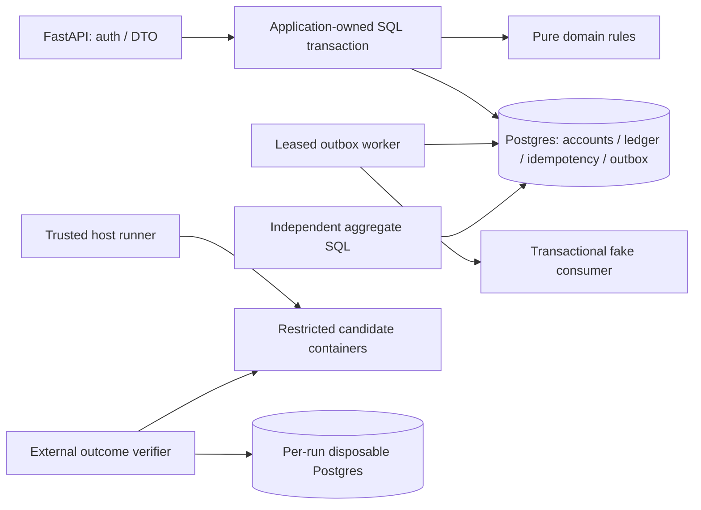

# Banking Transaction Debugging RL Lab

Working FastAPI/PostgreSQL simulation plus three reproducible engineering challenges for concurrency, idempotency and crash recovery.

[Hướng dẫn tiếng Việt](README.vi.md).

**Synthetic money only.** No real bank, customer data, payment rail or financial-regulatory/production-readiness claim. Default ports bind to localhost. Existing projects are independent.

## Run

Requires Docker Desktop/Compose v2, Git, Make and host Python 3.9+. Python **3.12** and all locked dependencies run inside containers; no host pip install required.

```sh
make up                       # generates ignored random .env secrets, migrates, starts API + worker
make seed                     # balanced treasury funding; repeatable
make test                     # fresh disposable database; never resets demo
make invariants               # independent SQL reconciliation
python3 scripts/demo.py        # real one-cent transfer + identical response replay
```

API documentation: [localhost:8010/docs](http://localhost:8010/docs). [Readiness](http://localhost:8010/health/ready), [metrics](http://localhost:8010/metrics). PostgreSQL: localhost:5440. Stop/resume with `make down` / `make up`; named volume persists.

Login emails: `alice@example.test`, `bob@example.test`, `admin@example.test`. Password is generated in ignored `.env` as `DEMO_PASSWORD`; no known active password is committed. Registration and treasury debits are controlled through seed CLI. `.env.example` documents variables; `make up` fills empty values safely.

## What is verified

- Strict BIGINT USD cents; paired immutable journal postings, deferred DB guards and treasury funding.
- Atomic balances, ledger, transfer, audit, outbox and original idempotent response; persisted business rejections.
- Source ownership; Argon2id; validated short-lived JWT; rotating/replay-revoked refresh families; PostgreSQL login throttling.
- UUID-ordered account locks and bounded whole-transaction retries. P1 user quotas additionally serialize same actor's requests across accounts.
- Signed compound history cursors; independent read-only reconciliation and intentional disposable drift detection.
- Outbox leases/fencing, retry/dead-letter, atomic fake inbox/effect, safe acknowledgement-loss recovery.
- Beneficiaries, per-user/account UTC limits, read-only financial investigation, audited admin operational actions.
- JSON logs, bounded Prometheus labels and propagated W3C/OpenTelemetry traces.

Actual evidence: **62 application tests** (final count confirmed in [test log](docs/evidence/final-core.log)), **56 task validation runs**, 11 executed incident scenarios, dependency audit, restore drill and controlled HTTP/history profile. See [evidence index](docs/evidence/README.md) for executed checks and limitations. No remote CI badge/run is claimed.

## Challenges

| Task | Problem | Difficulty | Recorded gates |
|---|---|---|---|
| [RL-01](challenges/RL-01-concurrent-transfers/instruction.md) | Concurrent withdrawals / stale reads | Hard | Baseline FAIL, golden PASS, optimistic and lock-only alternatives PASS |
| [RL-02](challenges/RL-02-idempotency-timeout/instruction.md) | Response lost after commit | Hard | Baseline FAIL, golden PASS |
| [RL-03](challenges/RL-03-crash-recovery/instruction.md) | Independent debit survives process crash | Hard | Baseline FAIL, golden PASS |

Each baseline/golden runs on five fresh deterministic seeds. All tasks reject no-op, partial, hardcoded, canned-success, disabled-endpoint, suppressed-error, deleted-evidence and unit-only controls. RL-01 runs 20 synchronized overspend rounds and 20 opposite-direction rounds per golden seed. RL-01/02 also verify 100 repeated cross-process requests. [Results and initial verifier weakness](docs/evaluation-results.md).

```sh
make challenge TASK=RL-01 MODE=baseline   # FAIL is expected candidate verdict; harness exits 0 only for expected verdict
make challenge TASK=RL-01 MODE=golden
make validate-tasks
python3 -m benchmark.self_check          # package fidelity + actual sandbox filesystem boundaries
python3 -m benchmark.cli materialize --task RL-01 --output /tmp/RL-01-workspace
```

Correct app stays in `src/`; intentional defects exist only as patches against pinned `core-v1.0.0`. Golden solutions are minimal patches from defective source. Candidate runtime has no reference source, grader, solutions, host Docker socket or internet route. Grader is a separate container with authoritative DB checks. Public portfolio solutions remain discoverable online; this is not a genuinely hidden benchmark.

## Architecture



[Architecture](docs/architecture.md), [ADRs](docs/adr/), [schema](docs/data-model.md), [API](docs/api-contract.md), [failure semantics](docs/failure-semantics.md), [threat model](docs/security/threat-model.md).

## Incident demonstrations

```sh
make scenario SCENARIO=INC-02             # killed response after committed money; safe replay
make scenario SCENARIO=INC-03             # actual process death at four posting boundaries
make scenario SCENARIO=INC-08             # receiver commits, worker loses ACK; deduplicated recovery
python3 scripts/restore_drill.py           # pauses this demo; restores NEW DB; checks digests + invariants
make load-test                            # fresh DB, 3 HTTP samples, 1k history transfers, EXPLAIN
```

Executed catalog: INC-01–08, INC-10, INC-11, INC-15. [Runbooks](docs/production-runbooks/), [incident reports](docs/incidents/), [interview walkthrough](docs/interview-demo.md). Every scenario cleans its disposable data; normal demo is untouched. Restore drill pauses/resumes this Compose API/worker, never overwrites source DB.

## Checks and boundaries

`make help` lists working targets. `make ci` runs Ruff, formatting, strict mypy, all tests and reconciliation. `make security-check` runs local leak guard plus locked dependency audit. GitHub Actions definitions exist; no repository has been pushed or remotely verified.

Optional telemetry example: `docker compose -f compose.yaml -f compose.observability.yaml --profile worker --profile observability up -d`. Collector/Prometheus config and Grafana dashboard are provided; external collector/dashboard containers have **not** been executed in this verification. Local trace propagation/logs/metrics are tested.

Read [acceptance matrix](docs/acceptance-matrix.md) and [readiness review](docs/production-readiness-review.md). Advanced RL-04–10, risk-review workflow, operator UI, 10k/100k performance validation, HA/PITR and remote CI remain outside this release. Destructive reset requires explicit `make reset-demo CONFIRM=DESTROY_LOCAL_DEMO`. Remove ignored artifacts with `make clean-artifacts`.
