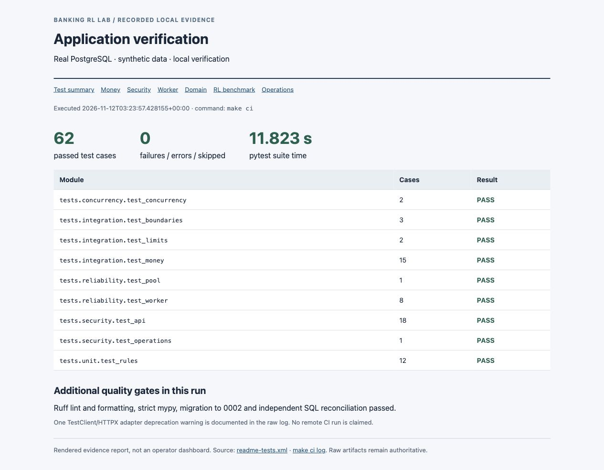
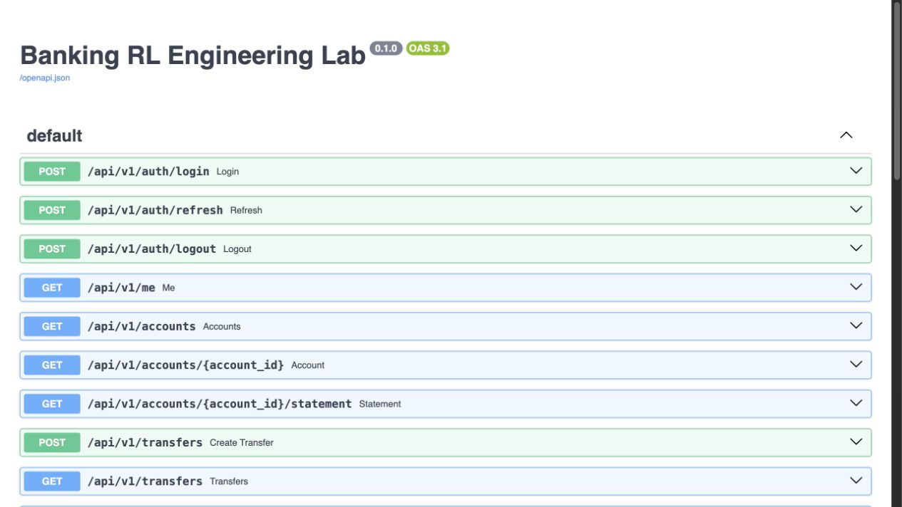
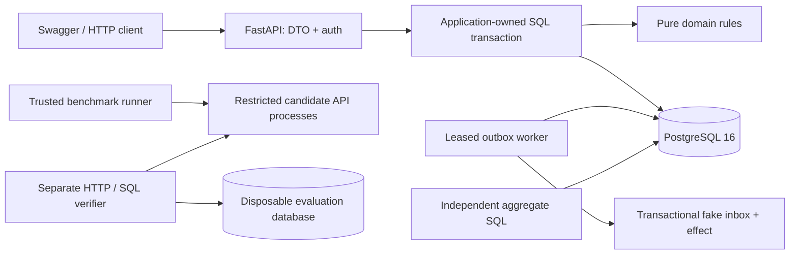
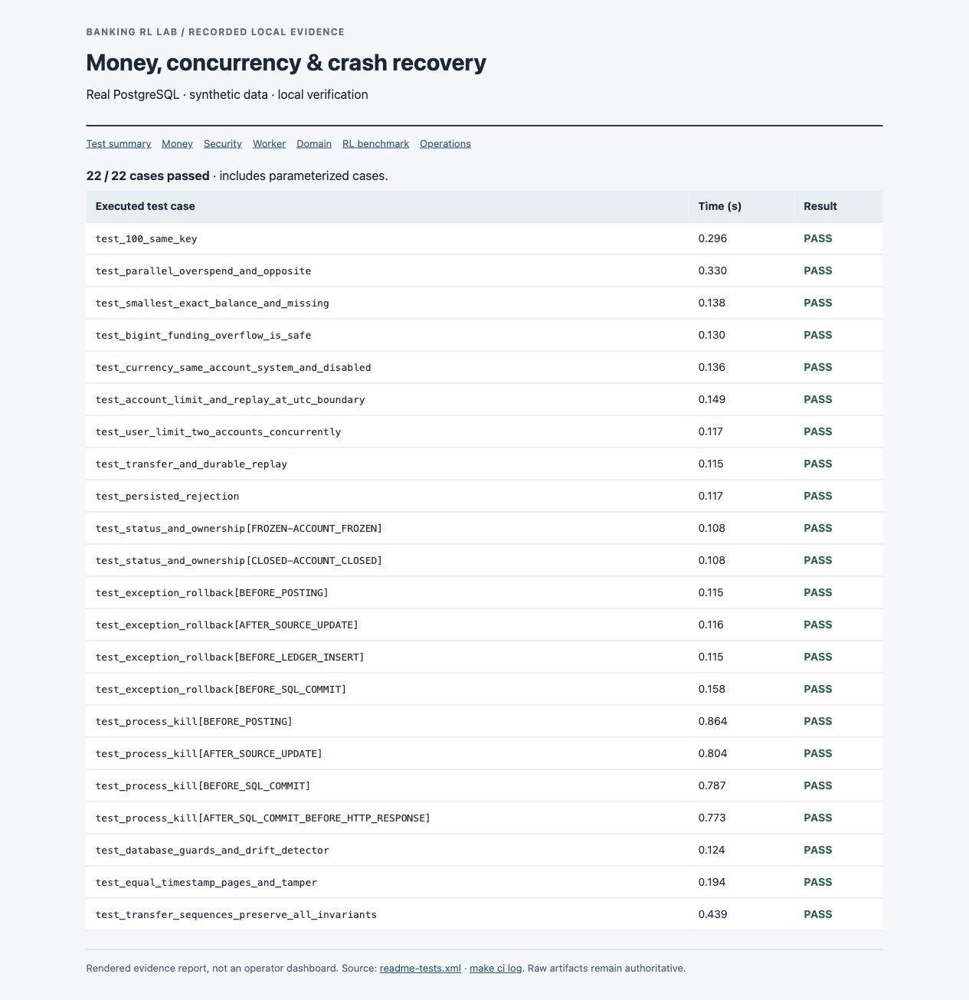
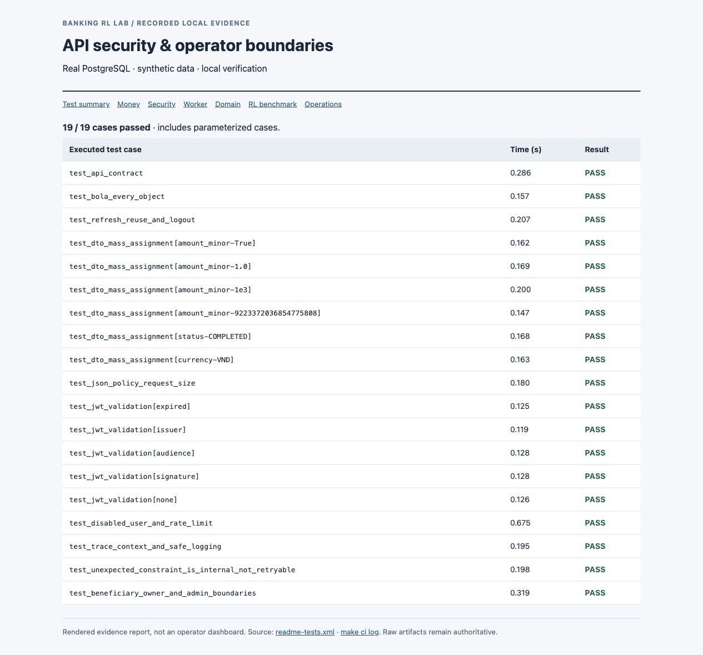
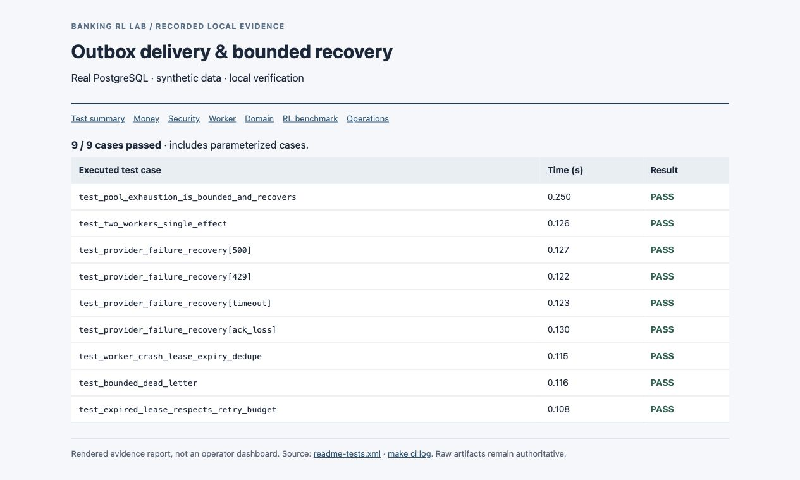
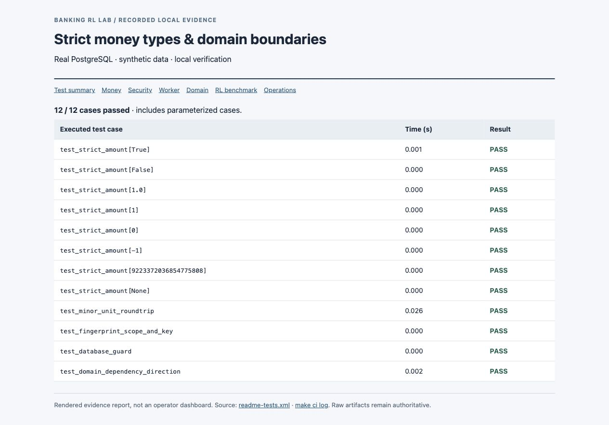
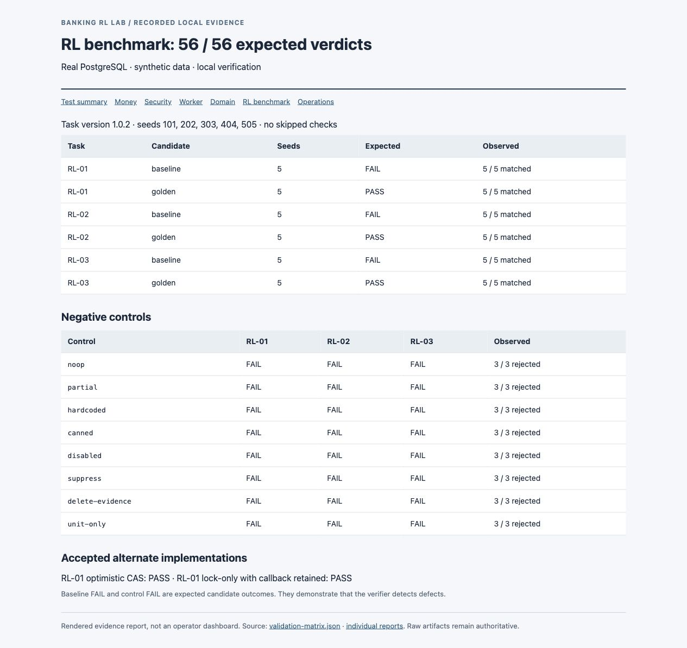
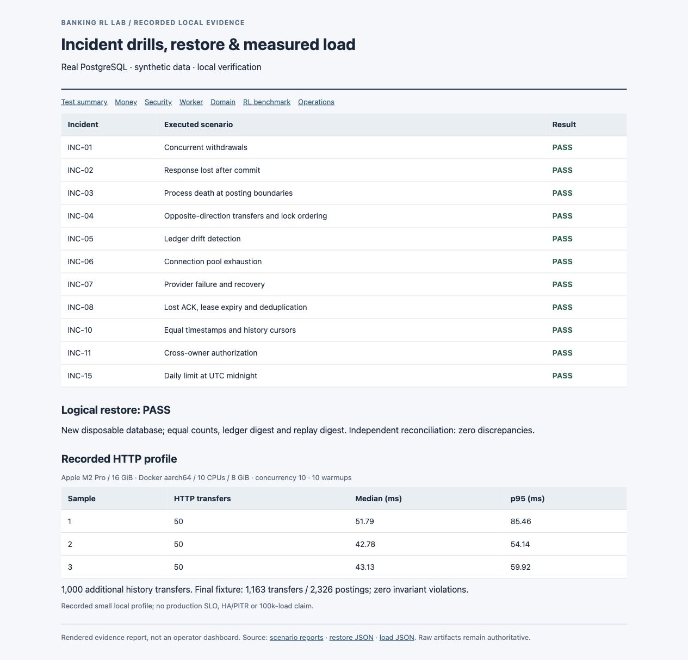

# Banking Transaction Debugging RL Lab

**A runnable banking simulation and reproducible debugging benchmark for coding agents.** The application keeps synthetic money consistent under retries, concurrent withdrawals and process crashes. Three RL tasks deliberately break that verified core, then measure whether a candidate repair restores observable behavior.

[Hướng dẫn chi tiết bằng tiếng Việt](README.vi.md) · [Full test catalogue](docs/test-catalogue.md) · [SRS acceptance matrix](docs/acceptance-matrix.md) · [Evidence index](docs/evidence/README.md)

> Synthetic money and fixtures only. Local engineering portfolio; no real banking integration, regulatory certification or production-readiness claim. P0 is verified locally; selected P1 features are implemented. Remaining scope is listed below.

## Reviewer overview

| What was actually executed | Recorded result | Inspect the source |
|---|---|---|
| Application verification on real PostgreSQL | **62 passed**, 0 failures/errors/skips; one adapter deprecation warning | [JUnit XML](docs/evidence/readme-tests.xml), [fresh `make ci` log](docs/evidence/readme-verification.log) |
| Challenge validation, task version 1.0.2 | **56/56 expected verdicts** across 3 tasks, 5 seeds, negative controls and alternate solutions | [Matrix](docs/evidence/validation-matrix.json), [individual reports](docs/evidence/challenges/) |
| Incident rehearsals | **11 executed scenarios** | [Scenario evidence](docs/evidence/scenarios/), [incident reports](docs/incidents/) |
| Backup and restore | New database; equal counts, ledger/replay digests; clean reconciliation | [Restore result](docs/evidence/backup-restore.json) |
| Controlled local performance profile | 3 × 50 HTTP transfers, concurrency 10; 1,000 extra history transfers | [Measured results](docs/evidence/load/result.json), [query plans](docs/evidence/load/) |
| Runtime and packaging | Live API, schema 0002, worker; restricted candidate filesystem checks | [Readiness](docs/evidence/health.json), [services](docs/evidence/running-services.log), [sandbox check](docs/evidence/sandbox-self-check.log) |

Recorded on **12 November 2026**, Apple M2 Pro / 16 GiB. Docker Desktop: Linux aarch64, 10 exposed CPUs, 8 GiB allocated. M1, remote amd64 and GitHub Actions were not executed. Application tests were rerun for these README images; benchmark/incident/performance images use their dated recorded results.



*Screenshot of a static report generated from the actual JUnit file and command log. Other evidence images follow the same rule; the report is a documentation artifact. [Image sources and provenance](docs/assets/screenshots/README.md).*

## Contents

- [What this project demonstrates](#what-this-project-demonstrates)
- [Quick start](#quick-start)
- [API walkthrough](#api-walkthrough)
- [Architecture and money invariants](#architecture-and-money-invariants)
- [Test cases and screenshots](#test-cases-and-screenshots)
- [RL challenges and verifier integrity](#rl-challenges-and-verifier-integrity)
- [Incident rehearsals](#incident-rehearsals)
- [Measured load and restore results](#measured-load-and-restore-results)
- [Operations and troubleshooting](#operations-and-troubleshooting)
- [Repository map and documentation](#repository-map-and-documentation)
- [Scope and known limits](#scope-and-known-limits)
- [Refresh the documentation evidence](#refresh-the-documentation-evidence)

## What this project demonstrates

| Area | Implemented behavior | Why it matters |
|---|---|---|
| Money and ledger | Strict signed 64-bit integer minor units, paired immutable postings, treasury-funded issuance | Avoid rounding errors and unexplained balance changes |
| Atomic posting | Balance updates, transfer, ledger, audit, outbox and idempotent response share one SQL transaction | Partial success cannot survive a pre-commit crash |
| Concurrency | UUID-ordered account locks; bounded whole-transaction retries; actor serialization for user-wide quotas | Prevent overspending and inconsistent daily usage |
| Retry semantics | Actor/operation/key scope plus request fingerprint; exact durable response replay | A lost response does not create a second financial intent |
| Authentication | Argon2id, short-lived JWT, rotating refresh families, reuse revocation, DB login throttling | Exercise meaningful authentication failures |
| Authorization | Owner checks, participant transfer visibility, masked foreign resources, explicit admin operations | Prevent cross-user object access |
| History and reconciliation | Signed compound keyset cursors; independent aggregate SQL | Detect omissions, tampering and ledger/cache drift |
| Delivery reliability | Leases, fencing, retry budget, dead-letter and atomic fake inbox/effect | Recover after provider errors or acknowledgement loss |
| Operations | Beneficiaries, UTC limits, admin investigation/re-drive, JSON logs, metrics and trace propagation | Connect core correctness to practical failure diagnosis |
| Agent evaluation | Pinned defective snapshots, minimal golden patches, external HTTP/SQL verifier and negative controls | Check outcomes independently of candidate-owned tests |

## Quick start

### Requirements

Docker Desktop with Compose v2, Git, Make and host Python **3.9+**. Python **3.12** and locked runtime/tool dependencies run in containers. No host pip installation is needed. Start Docker Desktop before running commands.

From the repository root:

```sh
make up                  # generate ignored random .env secrets, build, migrate, start API + worker
make seed                # repeatable treasury-funded demo accounts
python3 scripts/demo.py   # send one synthetic cent, repeat same key, assert identical response
make invariants          # independent SQL reconciliation
```

| Local surface | Address / purpose |
|---|---|
| Interactive API | [http://localhost:8010/docs](http://localhost:8010/docs) |
| OpenAPI schema | [http://localhost:8010/openapi.json](http://localhost:8010/openapi.json) |
| Process liveness | [http://localhost:8010/health/live](http://localhost:8010/health/live) |
| DB/schema readiness | [http://localhost:8010/health/ready](http://localhost:8010/health/ready) |
| Prometheus metrics | [http://localhost:8010/metrics](http://localhost:8010/metrics) |
| PostgreSQL | `127.0.0.1:5440`, database `banking_lab` |

Ports bind to localhost. Override `API_PORT` / `DB_PORT` in ignored `.env` if occupied. `make down` stops services and preserves the named database volume; `make up` resumes them.

### Demo identities

| Identity | Role | Intended use |
|---|---|---|
| `alice@example.test` | USER | Initiate transfers from Alice's customer accounts |
| `bob@example.test` | USER | Recipient / opposite-direction transfers |
| `admin@example.test` | ADMIN | Limits, reconciliation and outbox investigation/re-drive |

`DEMO_PASSWORD` is generated in local `.env`; open that file locally to obtain it. No active password is committed. Registration and SYSTEM treasury debits are controlled by the seed CLI. See [.env.example](.env.example).



*Actual browser capture of `/docs`. This project exposes Swagger and CLI demos; a React operator dashboard is not implemented.*

## API walkthrough

### 1. Authenticate and find accounts

In Swagger, expand `POST /api/v1/auth/login`, choose **Try it out**, and supply the demo email and local password. Use Alice for the transfer example below. For protected operations, enter `Bearer <access_token>` in the operation's **authorization** header field. The current schema models that header directly; it does not provide a global **Authorize** button.

Call `GET /api/v1/accounts` to obtain your source account ID. `make seed` also prints demo account IDs. Login responses contain tokens; keep them out of screenshots and committed evidence.

### 2. Create a transfer and retry it

Replace `<access_token>` with your local access token. These account IDs are the deterministic Alice/Bob demo accounts created by `make seed`:

```sh
curl -i http://localhost:8010/api/v1/transfers \
  -H 'Content-Type: application/json' \
  -H 'Authorization: Bearer <access_token>' \
  -H 'Idempotency-Key: reviewer-transfer-0001' \
  -d '{
    "source_account_id": "fc643569-ee5d-5c2a-9d21-e86c206dfe1d",
    "destination_account_id": "3457c09b-6269-5d84-9869-90b23e1f80ec",
    "amount_minor": 1,
    "currency": "USD",
    "reference": "reviewer-demo"
  }'
```

First request returns **201 COMPLETED**. Repeat the exact command: the original status/body return, with `Idempotent-Replayed: true`; only one transfer is posted. Change the amount while retaining the key: **409 IDEMPOTENCY_KEY_REUSED**. After a timeout or 503, retain the original body and key.

`amount_minor: 1` means **USD 0.01**. Accepted transfer amounts are positive integers through `2**63 - 1`; booleans, floats and numeric strings are rejected. Business validation also checks available balance, account status, currency, destination overflow and applicable daily limits.

For an executable walkthrough without handling tokens manually:

```sh
python3 scripts/demo.py
```

The [recorded demo output](docs/evidence/demo-flow.log) contains `status: COMPLETED`, `amount_minor: 1` and `exact_replay: true`. It does not print tokens. [Post-demo reconciliation](docs/evidence/demo-invariants.log) records 4 transfers / 8 postings and zero findings; these counts belong to that dated demo snapshot.

### 3. Inspect history and operational state

| Operation | Endpoint(s) | Boundary / result |
|---|---|---|
| Session | `POST /api/v1/auth/login`, `/auth/refresh`, `/auth/logout` | Rotation, replay revocation, idempotent logout |
| Identity | `GET /api/v1/me` | Active authenticated user |
| Accounts | `GET /api/v1/accounts`, `/accounts/{id}` | Owner-only account data |
| Statement | `GET /api/v1/accounts/{id}/statement` | Owner-only; signed keyset paging |
| Transfers | `POST /api/v1/transfers`, `GET /api/v1/transfers`, `/transfers/{id}` | Owned debit; participant visibility, explicit admin detail access |
| Beneficiaries | `GET/POST /api/v1/beneficiaries`, `PATCH /beneficiaries/{id}` | Owner-scoped alias/status management |
| Limits | `PUT /api/v1/admin/transfer-limits` | Admin; ACCOUNT or USER daily amount in minor units |
| Reconciliation | `POST /api/v1/admin/reconciliation-runs`, `GET /admin/reconciliation-runs/{id}` | Admin; independent financial analysis and persisted report |
| Outbox | `GET /api/v1/admin/outbox-events`, `POST /admin/outbox-events/{id}/retry` | Admin; bounded investigation and audited re-drive |

Paths abbreviated after the first entry remain under `/api/v1`. History `limit` is 1–100; cursors bind actor/account/filters and the traversal's upper key boundary. Later larger keys are excluded; backdated inserts below that boundary may appear. See [API contract](docs/api-contract.md).

Error envelope:

```json
{"error":{"code":"INSUFFICIENT_FUNDS","message":"...","request_id":"...","details":{}}}
```

| Status | Meaning |
|---|---|
| 401 / 403 / 404 | Invalid authentication / denied admin action / unavailable or masked resource |
| 409 | Business conflict, insufficient funds, limit exceeded or key reused with another intent |
| 413 / 422 | Request too large / malformed or disallowed input |
| 429 | Login throttle |
| 503 | Transient infrastructure error or uncertain outcome; retry same intent with same key |
| 500 | Unexpected internal constraint/error; not misclassified as a retryable business outcome |

## Architecture and money invariants



One posting transaction covers:

```text
validate intent and active actor
claim actor/operation/key; compare canonical request fingerprint
return persisted response on replay
lock account pair in UUID order; re-read balance/status/ownership
check amount, balances, currency, overflow and UTC limits
write paired ledger + balances + transfer + audit + outbox + response
commit SQL transaction
return HTTP response
```

Same-actor requests additionally serialize in the P1 app to make user-wide limits correct across multiple source accounts. The challenge base pins the earlier verified P0 implementation.

| Invariant | Enforcement / independent check |
|---|---|
| Posted journal balances | Paired postings sum to zero in the same currency |
| Customer balance never negative | Locked validation plus database guards |
| Cached balance equals ledger sum | Deferred projection checks and independent reconciliation |
| Terminal success is complete | Transfer, journal, replay result and outbox agree |
| Ledger/audit history is immutable | Database mutation restrictions / runtime role separation |
| Same intent posts once | Unique actor/operation/key claim plus atomic original response |
| Pre-commit crash leaves no partial money | SQL rollback; actual subprocess crash tests |
| Delivery retry has one semantic effect | Atomic inbox receipt + fake effect; fencing prevents stale acknowledgement |

[Architecture](docs/architecture.md) · [Data model](docs/data-model.md) · [ADRs](docs/adr/) · [Failure semantics](docs/failure-semantics.md) · [Threat model](docs/security/threat-model.md)

## Test cases and screenshots

The current application suite contains **62 pytest cases**. Parameterized inputs count separately; Hypothesis-generated examples are not added to that total. Integration/security/reliability tests use a newly migrated disposable PostgreSQL database. Most API tests use FastAPI TestClient; the benchmark, live demo and load profile use separate running HTTP processes.

The screenshots below contain the exact executed test IDs, result and measured duration. [Full 62-case catalogue](docs/test-catalogue.md) links each case to its source; [JUnit](docs/evidence/readme-tests.xml) and [raw log](docs/evidence/readme-verification.log) preserve machine-readable results.

### Money, concurrency, limits and crash recovery — 22 cases

| Case family / source | Trigger | Assertions verified |
|---|---|---|
| [Durable replay](tests/integration/test_money.py) | Submit the same intent twice | Same original response; one financial operation; changed body with the same key conflicts |
| [Stable business rejection](tests/integration/test_money.py) | Insufficient funds, then later funding | Original rejected result still replays; no rejected money postings |
| [Frozen / closed](tests/integration/test_money.py) | Destination status changes to FROZEN or CLOSED | ACCOUNT_FROZEN / ACCOUNT_CLOSED; no money mutation |
| [Exact balance / missing resource](tests/integration/test_boundaries.py) | Spend exact available balance, then one more cent; correct a missing source | Exact-balance success; insufficient-funds rejection; rolled-back claim permits corrected request |
| [BIGINT overflow](tests/integration/test_boundaries.py) | Reach the signed 64-bit destination ceiling | One more cent is rejected; ledger remains balanced |
| [Currency / source boundaries](tests/integration/test_boundaries.py) | EUR destination, same source/destination, SYSTEM source, disabled actor | Appropriate domain/authorization rejection |
| [100 duplicate calls](tests/concurrency/test_concurrency.py) | 100 calls, 16 worker threads, same key | All responses 201; one transfer ID; exactly one original posting |
| [Parallel overspend / opposite direction](tests/concurrency/test_concurrency.py) | Two 70,000-cent debits from 100,000 cents; 20 opposing rounds | Outcomes 201 and 409; opposite transfers finish; customer balance stays non-negative |
| [Rollback, 4 boundaries](tests/integration/test_money.py) | Exception before posting, after debit, before ledger insert or commit | Counts and balances unchanged; retry succeeds |
| [Process death, 4 boundaries](tests/integration/test_money.py) | Subprocess exits before posting, after debit, before commit or after commit/before response | Pre-commit rollback; post-commit retry replays; exactly one final transfer |
| [Drift / history](tests/integration/test_money.py) | Disposable ledger/cache drift; 24 equal-timestamp transfers; tampered cursor | BALANCE_DRIFT detected; complete unique traversal; invalid cursor rejected |
| [UTC limits](tests/integration/test_limits.py) | Midnight boundary, replay across days, concurrent debits from two accounts | Correct day bucket; original success/rejection preserved; shared user quota cannot be bypassed |



### API security and operator boundaries — 19 cases

| Case family / source | Trigger | Assertions verified |
|---|---|---|
| [API contract](tests/security/test_api.py) | Authenticated/unauthenticated access; create and replay transfer | 401 without auth; 201 success; original replay body/header; owned history available |
| [BOLA](tests/security/test_api.py) | Replace account/statement/transfer UUID or debit Bob's source as Alice | Masked 404 or denied 403; foreign balance is not leaked |
| [Refresh reuse / logout](tests/security/test_api.py) | Reuse rotated token, then try its replacement; logout twice | Family revoked; refresh returns 401; logout stays 204 |
| [Strict DTOs, 6 inputs](tests/security/test_api.py) | Boolean/float/string/overflow amount, injected status, unsupported currency | 422; protected fields cannot be mass-assigned |
| [JSON policy](tests/security/test_api.py) | Duplicate object key or oversized body | 422 or 413; structured error for unknown route |
| [JWT validation, 5 inputs](tests/security/test_api.py) | Expired token, wrong issuer/audience/signature, unsigned token | 401 for each invalid token |
| [Disabled user / throttle](tests/security/test_api.py) | Disable active actor; repeated invalid logins | Access revoked; throttle returns 429 |
| [Trace / logging](tests/security/test_api.py) | Incoming trace context and synthetic sensitive fields | Trace/request correlation retained; password, authorization and test email absent from logs |
| [Unexpected constraint](tests/security/test_api.py) | Inject non-transient integrity failure | 500 INTERNAL_ERROR; no Retry-After; financial counts unchanged |
| [Operator boundaries](tests/security/test_operations.py) | Cross-owner beneficiary update; USER calls admin endpoints; admin limit/re-drive | Ownership isolation; 403 for USER; permitted actions audited; safe event output |



### Worker and infrastructure recovery — 9 cases

| Source | Fault / schedule | Assertions verified |
|---|---|---|
| [Pool exhaustion](tests/reliability/test_pool.py) | Hold the only available pool connection | Bounded 503; no financial mutation; later request recovers |
| [Concurrent workers](tests/reliability/test_worker.py) | Concurrent ticks claim the same outbox population | One inbox receipt/effect per event |
| [Provider failures, 4 modes](tests/reliability/test_worker.py) | 500, 429, timeout, acknowledgement loss | Money remains committed; healthy retry completes without duplicate effect |
| [Worker crash after delivery](tests/reliability/test_worker.py) | Controlled exception before outbox ACK, then lease expiry | Deduplicated recovery after 31 simulated seconds |
| [Dead-letter budget](tests/reliability/test_worker.py) | Provider fails through configured attempt limit | Event enters DEAD; reconciliation reports OUTBOX_STUCK |
| [Expired lease budget](tests/reliability/test_worker.py) | Crash before provider delivery with budget exhausted | LEASE_RETRY_EXHAUSTED; retry count remains bounded |

The worker fault is a controlled exception/clock injection. Application posting tests separately prove actual subprocess death; these are different fault mechanisms.



### Pure domain and safety guards — 12 cases

[Domain tests](tests/unit/test_rules.py) reject 8 invalid amount forms, exercise integer round trips with Hypothesis, bind fingerprints to actor/intent, enforce local/disposable DB boundaries, and check that the domain does not depend on application/framework infrastructure.

<details>
<summary>View all 12 executed domain cases</summary>



</details>

### Run the checks yourself

```sh
make ci                  # Ruff, formatting, strict mypy, all tests, reconciliation
make security-check      # local heuristic leak guard + locked runtime dependency audit
make test-unit
make test-integration
make test-concurrency
make test-security

# One named case, on a fresh disposable DB:
docker compose run --rm -T tools scripts/run_tests.py \
  tests/security/test_api.py::test_bola_every_object -q
```

These checks do not reset demo data. One TestClient/HTTPX adapter deprecation warning is retained in the log; 62 tests still passed. Dependency audit found no known runtime vulnerabilities at its recorded run; the local leak guard is heuristic, not an external security certification.

## RL challenges and verifier integrity

Each task includes instructions, metadata, pinned base, defect patch, minimal golden patch, controls and a separate verifier. Main `src/` remains correct. Baseline means the intentionally defective candidate; golden means the reference repair.

| Task | Defect / observed baseline failure, seed 101 | Golden contract | Five-seed gate |
|---|---|---|---|
| [RL-01](challenges/RL-01-concurrent-transfers/instruction.md) | Stale account snapshots; overspend returned `[201, 503]` instead of `[201, 409]`; opposite-direction failure | Locked re-read or valid optimistic retry; correct business outcome and liveness | Baseline FAIL × 5; golden PASS × 5 |
| [RL-02](challenges/RL-02-idempotency-timeout/instruction.md) | Replay status/body changes across processes; rejected result changes after funding | Durable actor-scoped response and stable rejection survive response loss | Baseline FAIL × 5; golden PASS × 5 |
| [RL-03](challenges/RL-03-crash-recovery/instruction.md) | Partial debit survives crash; seed 101 reports 2 BALANCE_DRIFT findings | One transaction across debit/credit/journal/replay/outbox; safe retry at four crash boundaries | Baseline FAIL × 5; golden PASS × 5 |

**56/56 expected verdicts** means 30 baseline/golden runs, 24 negative-control runs and 2 accepted RL-01 alternatives. A baseline/control **FAIL is expected evidence of defect detection**, not a failure concealed as a green application test. Environment errors, timeouts and verifier errors do not satisfy the gate.



| Negative control | Why the verifier must reject it |
|---|---|
| `noop` | Original defect left unchanged |
| `partial` | Fix limited to a subset of the required behavior |
| `hardcoded` | Canned fixture-specific intent/result |
| `canned` | Success response without correct authoritative state |
| `disabled` | Required endpoint disabled |
| `suppress` | Errors suppressed without restoring outcome |
| `delete-evidence` | Candidate-local evidence removal cannot change external SQL truth |
| `unit-only` | Local test changes do not repair runtime behavior |

Seeds: **101, 202, 303, 404, 505**. RL-01 golden performs 20 synchronized overspend rounds and 20 opposite-direction rounds per seed. RL-01/02 exercise 100 same-key retries across two API processes. RL-03 kills real processes at posting boundaries.

RL-01 accepts both an **optimistic CAS** solution and a **lock-only** solution that retains the public callback. Task version 1.0.2 synchronizes before candidate transactions and releases the unsafe-read checkpoint when its peer is lock-blocked. This protects correct locking designs from an unfair schedule.

```sh
make challenge TASK=RL-01 MODE=baseline  # expected candidate FAIL; harness verifies that expectation
make challenge TASK=RL-01 MODE=golden
make challenge TASK=RL-01 MODE=alternative
make challenge TASK=RL-01 MODE=lock-only
make validate-tasks                     # complete matrix; slower than application tests
python3 -m benchmark.self_check

python3 -m benchmark.cli materialize --task RL-01 --output /tmp/RL-01-workspace
# Edit only the candidate workspace, then evaluate it:
python3 -m benchmark.cli run --task RL-01 --mode candidate --candidate /tmp/RL-01-workspace
```

Source is pinned to `core-v1.0.0` (`d1cee249883627d9bca4371aa547d6c16d7c3303`). Each evaluation gets fresh PostgreSQL, an internal network, two candidate processes and a separate authoritative HTTP/SQL verifier. Candidate containers are non-root/read-only, with no reference/solution/verifier/Docker-socket mounts. Host orchestration never imports candidate modules.

The initial failed matrix exposed a PID-local negative-control weakness; it is preserved, along with the later successful pre-fairness matrix. [Results and corrections](docs/evaluation-results.md), [authoring guide](docs/benchmark-authoring.md), [isolation ADR](docs/adr/007-verifier-isolation.md). Published solutions are portfolio-public; runtime isolation does not make this a genuinely hidden internet benchmark. The task schema is this project's own runner schema, not a claimed Harbor/Terminal-Bench certification.

## Incident rehearsals

Each command below executes an isolated test/evaluation and writes actual logs/JSON. These are simulated incidents. INC-01 and INC-04 share the concurrency test; the latter demonstrates opposite-direction lock ordering/liveness, not a separately forced PostgreSQL deadlock.

| Scenario | Exercise | Verified result | Evidence |
|---|---|---|---|
| INC-01 | Concurrent withdrawals | One success/one rejection; no negative customer money | [Report](docs/evidence/scenarios/INC-01.json) |
| INC-02 | Response lost after commit | Retry recovers original transfer | [Report](docs/evidence/scenarios/INC-02.json) |
| INC-03 | Process death at four boundaries | Rollback before commit; replay after commit | [Report](docs/evidence/scenarios/INC-03.json) |
| INC-04 | Opposite-direction transfers | Ordered locking completes opposing requests | [Report](docs/evidence/scenarios/INC-04.json) |
| INC-05 | Disposable ledger/cache drift | Independent discrepancy detected | [Report](docs/evidence/scenarios/INC-05.json) |
| INC-06 | Pool exhaustion | Bounded failure and recovery | [Report](docs/evidence/scenarios/INC-06.json) |
| INC-07 | Provider 500/429/timeout/ACK loss | Retry recovery; money unchanged | [Report](docs/evidence/scenarios/INC-07.json) |
| INC-08 | Worker stops after delivery | Lease recovery and inbox deduplication | [Report](docs/evidence/scenarios/INC-08.json) |
| INC-10 | Equal timestamps / cursor tampering | Complete unique history; invalid cursor rejected | [Report](docs/evidence/scenarios/INC-10.json) |
| INC-11 | Cross-owner object access | Denied/masked resources without balance leakage | [Report](docs/evidence/scenarios/INC-11.json) |
| INC-15 | Midnight UTC / shared user limit | Correct daily bucket and cross-account quota | [Report](docs/evidence/scenarios/INC-15.json) |

```sh
make scenario SCENARIO=INC-02
make scenario SCENARIO=INC-03
make scenario SCENARIO=INC-08
```



[Incident reports](docs/incidents/) describe symptoms, reproduction, evidence and recovery. [Runbooks](docs/production-runbooks/) cover transfer uncertainty, outbox backlog, ledger discrepancy, auth, pool exhaustion, deployment/rollback and restore. [Interview walkthrough](docs/interview-demo.md) combines three reproducible demonstrations.

## Measured load and restore results

### HTTP and history profile

Actual local profile: 10 warmups; 3 samples of 50 unique successful transfers; concurrency 10; 1,000 additional history transfers. The final fixture contained **1,163 transfers / 2,326 postings**, with zero invariant violations.

| Sample | Successful HTTP transfers | Median (ms) | p95 (ms) |
|---|---:|---:|---:|
| 1 | 50 | 51.79 | 85.46 |
| 2 | 50 | 42.78 | 54.14 |
| 3 | 50 | 43.13 | 59.92 |

Native `ANALYZE` changed the recorded history plan from bitmap scan/sort to index scan. Both [before](docs/evidence/load/history-explain-before-analyze.json) and [after](docs/evidence/load/history-explain.json) plans are retained. This small, shared-host profile establishes the measured result only; it does not establish production throughput, p99/SLO, 10k/100k behavior or isolated benchmark performance.

```sh
make load-test
```

### Logical restore drill

The recorded drill paused/resumed this local API/worker, took a logical backup, restored it into a **new** disposable database, compared counts plus ledger/replay digests and reconciled independently. Source and restored snapshot both contained **3 transfers / 6 postings**; this earlier backup fixture differs from the later demo/load fixtures. [Actual result](docs/evidence/backup-restore.json), [log](docs/evidence/backup-restore.log).

```sh
python3 scripts/restore_drill.py
```

One drill does not establish HA, WAL/PITR or a production RPO/RTO.

## Operations and troubleshooting

| Command | Purpose |
|---|---|
| `make up`, `make down` | Start/rebuild or stop while preserving demo volume |
| `make seed` | Idempotent fixture funding |
| `make ci` | Application quality gates and reconciliation |
| `make security-check` | Leak guard plus dependency audit |
| `make invariants` / `make reconcile` | Independent SQL analysis |
| `make validate-tasks` | Complete RL validation matrix |
| `make scenario SCENARIO=INC-08` | One incident rehearsal |
| `make load-test` | Disposable HTTP/history profile |
| `make help` | Available targets |

Logs are structured JSON. Request IDs and W3C/OpenTelemetry trace context propagate through the application and outbox. Prometheus labels use bounded route/outcome values. Local trace propagation, redaction and metrics are tested.

Optional collector/Prometheus configuration:

```sh
docker compose -f compose.yaml -f compose.observability.yaml \
  --profile worker --profile observability up -d
```

Collector/Prometheus configurations and a Grafana dashboard JSON are supplied. External collector/dashboard execution is **unverified**; no live Grafana screenshot is claimed.

| Symptom | Next check |
|---|---|
| Docker connection error | Start Docker Desktop, then `docker info` |
| Port already used | Change `API_PORT` / `DB_PORT` in local `.env`, then `make up` |
| Readiness returns 503 | `docker compose ps`; `docker compose logs --tail=100 migrate api` |
| 401 on a protected Swagger operation | Fill that operation's `authorization` header with `Bearer <access_token>` |
| Unknown transfer outcome | Retain original key/body; retry and investigate by request/transfer ID |
| Outbox event remains DEAD | Inspect provider condition and retry budget; use audited admin re-drive after diagnosis |
| Reconciliation finds drift | Preserve evidence and follow [ledger discrepancy runbook](docs/production-runbooks/ledger-discrepancy.md); no automatic financial repair endpoint exists |

Destructive local reset: `make reset-demo CONFIRM=DESTROY_LOCAL_DEMO` deletes the demo volume. `make clean-artifacts` removes ignored generated artifacts; committed evidence under `docs/evidence/` remains.

## Repository map and documentation

```text
src/banking_lab/       domain rules, application services, API, DB/worker, telemetry
alembic/              schema migrations and database invariant guards
tests/                unit, integration, concurrency, security, reliability
benchmark/            trusted runner, public scheduling adapter, external verifier
challenges/           RL-01–03 instructions, defect/golden/control patches
scenarios/            named incident entry points and explanations
scripts/              seed/bootstrap support, load/restore/demo/evidence tools
infra/                Docker images and optional observability configuration
docs/evidence/        dated logs, JUnit, JSON reports and static reviewer pages
docs/assets/          committed screenshots and provenance
docs/adr/             engineering decisions and tradeoffs
.github/workflows/    core, challenge integrity and security workflow definitions
```

| Read | Purpose |
|---|---|
| [Implementation plan](docs/implementation-plan.md) / [changelog](CHANGELOG.md) | Milestones, decisions and verified checkpoints |
| [Architecture](docs/architecture.md) / [data model](docs/data-model.md) / [ADRs](docs/adr/) | Code/data boundaries and tradeoffs |
| [API contract](docs/api-contract.md) / [failure semantics](docs/failure-semantics.md) | Public behavior and retry rules |
| [Full test catalogue](docs/test-catalogue.md) / [evidence index](docs/evidence/README.md) | Every executed test ID and primary evidence |
| [Benchmark results](docs/evaluation-results.md) / [authoring guide](docs/benchmark-authoring.md) | Expected failures, alternate solutions and verifier corrections |
| [Runbooks](docs/production-runbooks/) / [incidents](docs/incidents/) / [demo script](docs/interview-demo.md) | Reproduction, investigation and walkthroughs |
| [Threat model](docs/security/threat-model.md) / [security policy](SECURITY.md) | Trust boundaries and responsible use |
| [Acceptance matrix](docs/acceptance-matrix.md) / [readiness review](docs/production-readiness-review.md) | Implemented, partial and deferred scope |

## Scope and known limits

| Scope | Current status |
|---|---|
| P0 milestones 0–8 | Verified locally: runnable core, correctness/security/concurrency/crash checks, three independently evaluated RL tasks |
| P1 worker | Implemented and locally verified |
| P1 richer domain | Beneficiaries, UTC account/user limits and admin investigation/re-drive; risk-review queue and full audit search/export remain open |
| P1 operations | 11 executed scenarios, runbooks, local telemetry; external collector/dashboard and remaining incident catalog unverified |
| Advanced tasks and scale | RL-04–10, 10k/100k profiles and broader contention/scaling work remain open |
| Operator UI | Optional React/Playwright UI not implemented; Swagger and CLI provided |
| Release qualification | GitHub workflows defined but unrun remotely; no external review, production deployment, HA/PITR or full release certification |

Engineering ceilings: same-actor transfers serialize for quota correctness; deferred projection checks recompute ledger sums; performance at 100k is unmeasured. Access JWTs may remain valid until expiry after refresh logout. History uses a logical upper key boundary, not a cross-request MVCC snapshot. The fake consumer proves one semantic effect under retries, not exactly-once network delivery. See the [readiness review](docs/production-readiness-review.md) for the complete limits.

## Refresh the documentation evidence

```sh
make ci > docs/evidence/readme-verification.log 2>&1
python3 scripts/build_readme_evidence.py --junit artifacts/tests.xml

# Rebuild reports from the committed evidence without rerunning app tests:
python3 scripts/build_readme_evidence.py

# View the generated pages locally; stop this temporary server with Ctrl-C:
python3 -m http.server 8765 --bind 127.0.0.1
```

Open [the static reviewer report](http://127.0.0.1:8765/docs/evidence/reviewer/test-summary.html) after starting that server. The builder uses Python's standard library and checks JUnit counts/outcomes, the 56-row expected-verdict matrix, scenario results, restore equality and load invariants. It produces seven HTML reports and the full test catalogue. Existing recorded RL/scenario/load results are read, not silently rerun.

Capture updated browser screenshots from those pages and `/docs`, save under `docs/assets/screenshots/`, and update [image provenance](docs/assets/screenshots/README.md). Every image should remain traceable to its dated log/JSON/XML source. Runtime secrets and tokens are excluded from screenshots.
