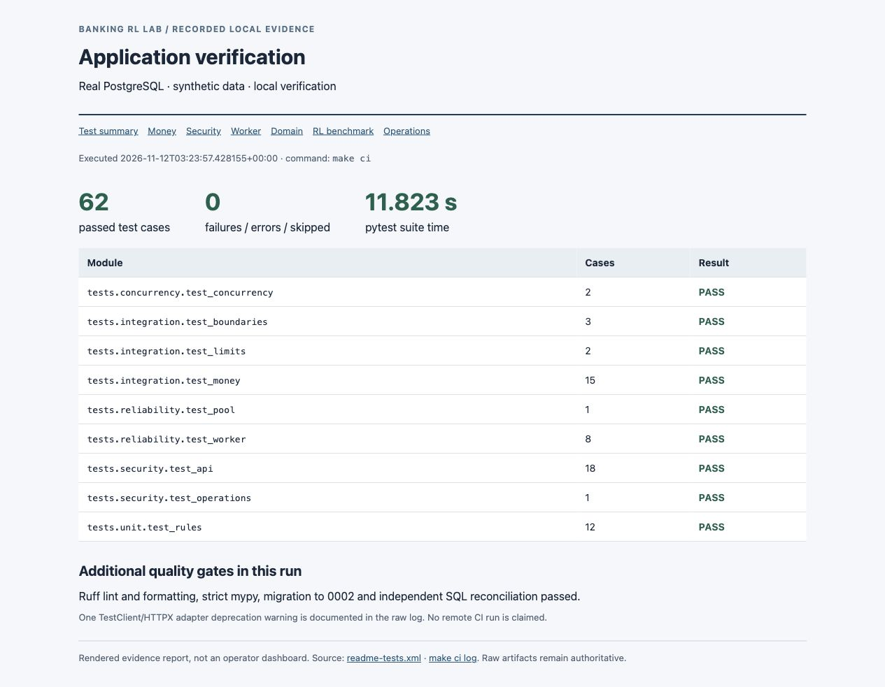
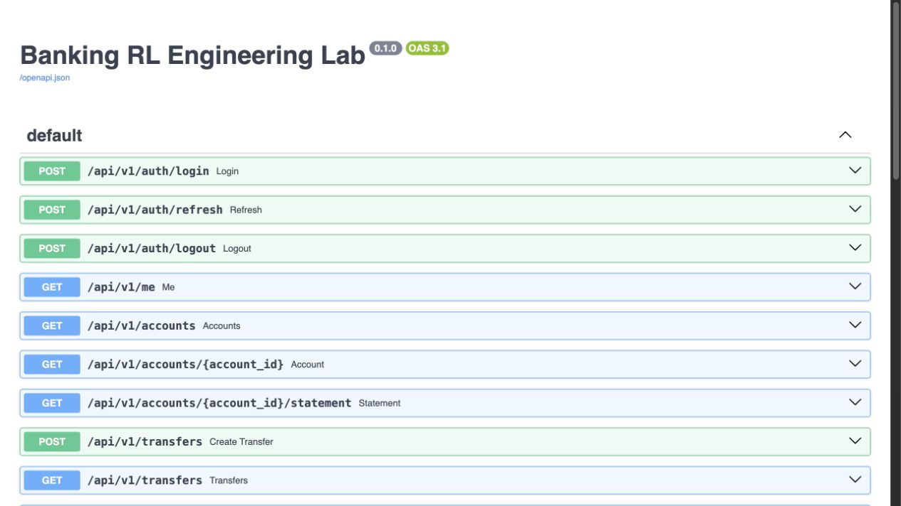
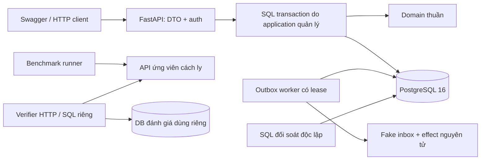
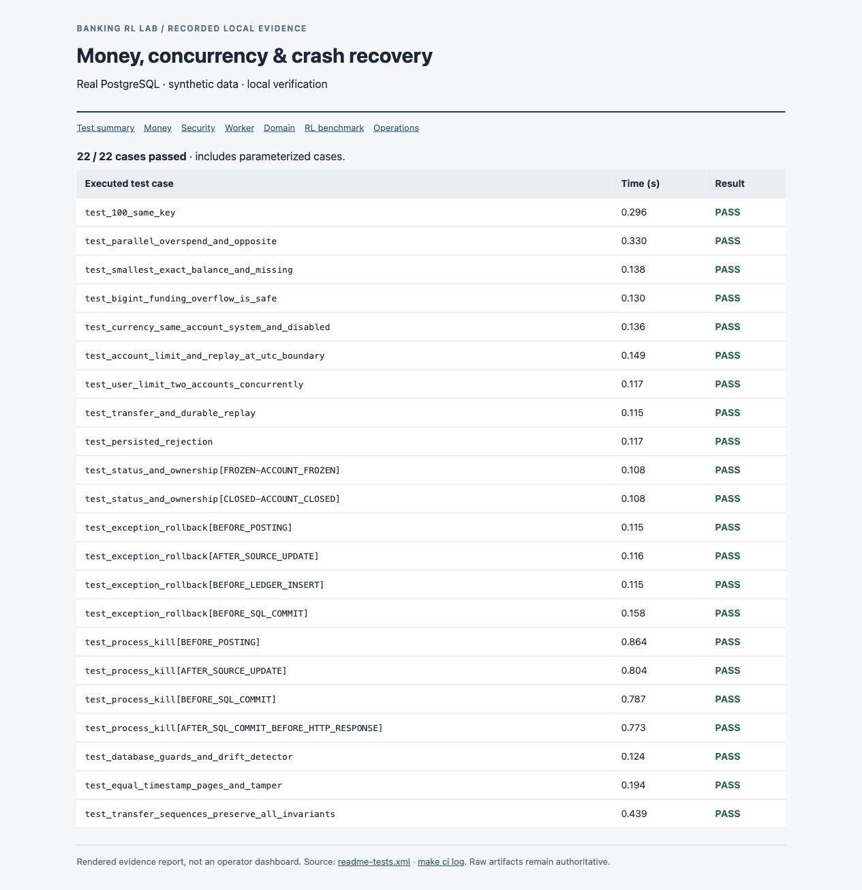
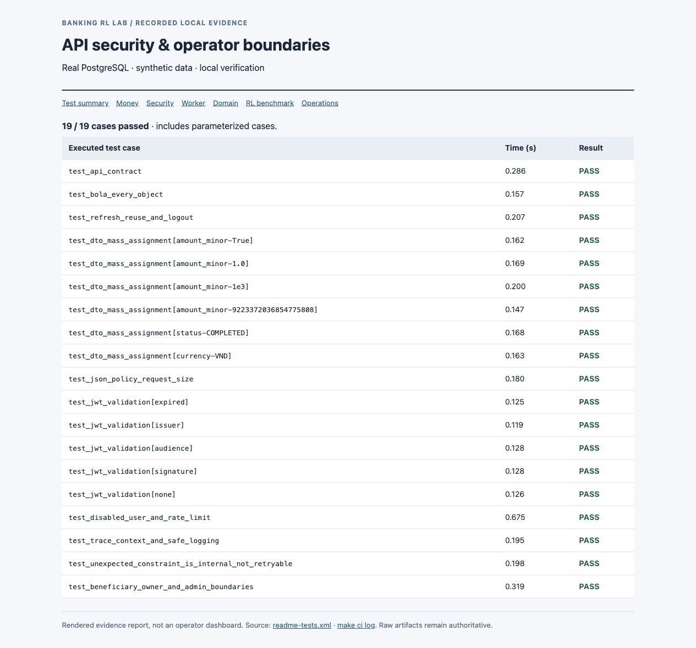
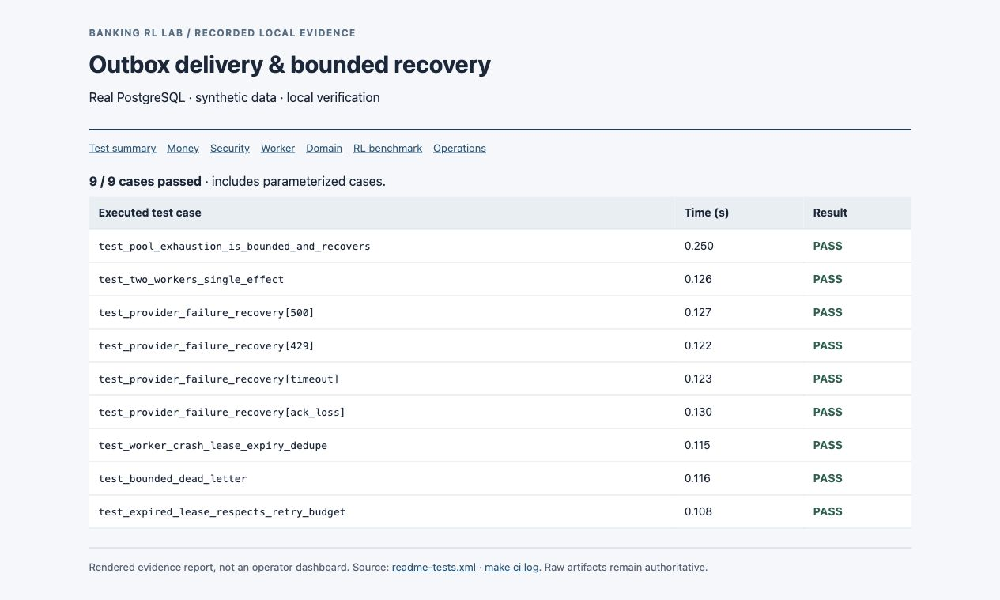
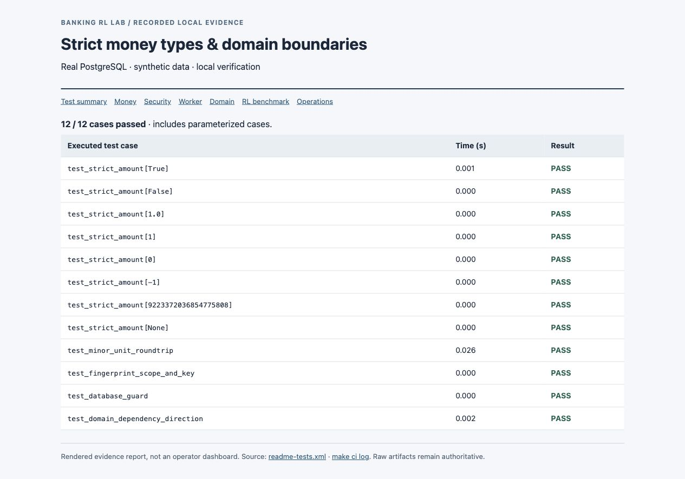
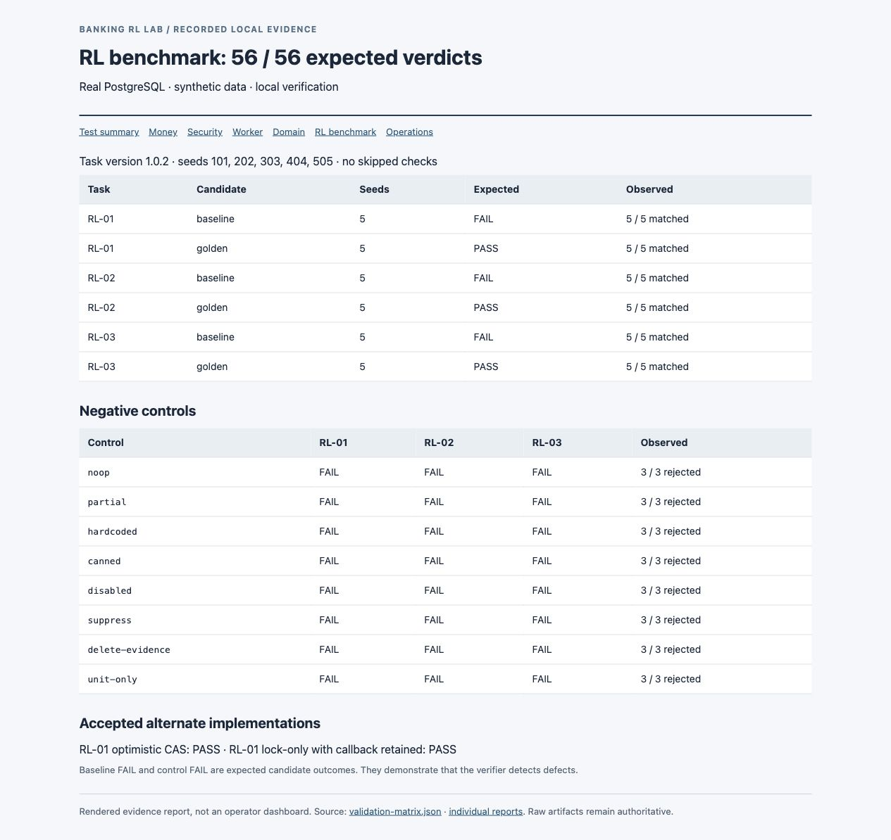
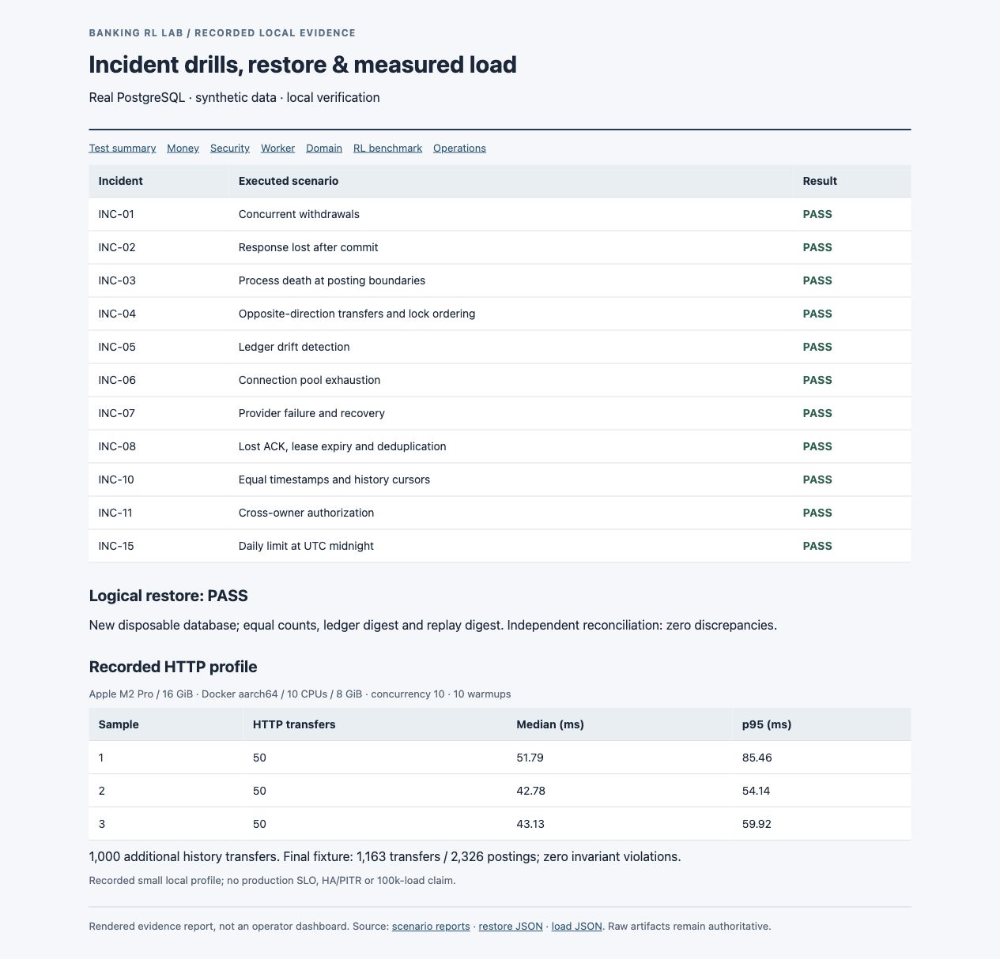

# Banking Transaction Debugging RL Lab

**Project mô phỏng giao dịch ngân hàng và bộ bài tập sửa lỗi cho coding agent.** Lõi ứng dụng xử lý tiền giả lập đúng khi gửi lại yêu cầu, rút tiền đồng thời hoặc tiến trình bị dừng đột ngột. Ba bài RL tạo lỗi có chủ đích từ lõi đã kiểm chứng, rồi dùng bộ chấm HTTP/SQL độc lập để đánh giá bản sửa.

[English README](README.md) · [Danh sách đủ 62 ca kiểm thử](docs/test-catalogue.md) · [Bảng nghiệm thu SRS](docs/acceptance-matrix.md) · [Bằng chứng chạy thật](docs/evidence/README.md)

> Chỉ dùng tiền, tài khoản và dữ liệu giả lập. P0 đã kiểm chứng cục bộ, P1 hoàn thành một phần. Đây là portfolio kỹ thuật; chưa phải hệ thống ngân hàng vận hành thực tế. Phạm vi còn mở được ghi rõ ở cuối tài liệu.

## 1. Người xem nên bắt đầu từ đâu?

Có thể đánh giá project theo ba bước:

1. Xem ảnh tổng quan và bảng ca kiểm thử bên dưới; mở log/JUnit/JSON nếu muốn đối chiếu.
2. Chạy `make up`, `make seed`, `python3 scripts/demo.py` để thử giao dịch và gửi lại cùng khóa.
3. Chạy một bản lỗi và một bản sửa của RL-01 để thấy bộ chấm phân biệt hành vi đúng/sai.

| Hạng mục đã chạy | Kết quả ghi nhận | Bằng chứng gốc |
|---|---|---|
| Kiểm thử ứng dụng với PostgreSQL thật | **62 ca qua**, 0 failure/error/skipped; 1 cảnh báo adapter | [JUnit](docs/evidence/readme-tests.xml), [log chạy lại `make ci`](docs/evidence/readme-verification.log) |
| Chấm 3 bài RL, phiên bản 1.0.2 | **56/56 lượt đúng kỳ vọng** | [Ma trận](docs/evidence/validation-matrix.json), [từng báo cáo](docs/evidence/challenges/) |
| Diễn tập sự cố | **11 kịch bản đã chạy** | [Log/JSON](docs/evidence/scenarios/), [báo cáo sự cố](docs/incidents/) |
| Sao lưu và khôi phục | DB mới có cùng số bản ghi, digest sổ cái/kết quả replay; đối soát sạch | [Kết quả restore](docs/evidence/backup-restore.json) |
| Đo tải cục bộ | 3 × 50 giao dịch HTTP, concurrency 10; thêm 1.000 giao dịch lịch sử | [Số đo](docs/evidence/load/result.json), [EXPLAIN](docs/evidence/load/) |
| Chạy dịch vụ và cách ly bộ chấm | API schema 0002, worker; kiểm tra filesystem ứng viên đã qua | [Readiness](docs/evidence/health.json), [dịch vụ](docs/evidence/running-services.log), [sandbox](docs/evidence/sandbox-self-check.log) |

Bằng chứng ngày **12/11/2026** trên Apple M2 Pro / RAM 16 GiB; Docker Desktop Linux aarch64, 10 CPU được cấp, RAM 8 GiB. Chưa chạy thực tế trên M1, amd64 từ xa hoặc GitHub Actions. Bộ kiểm thử ứng dụng được chạy lại để làm ảnh README; ảnh RL/sự cố/hiệu năng dùng kết quả đã ghi nhận tại thời điểm tương ứng.



*Ảnh chụp báo cáo tĩnh dựng từ JUnit và log chạy thật. Đây là tài liệu bằng chứng; project chưa có dashboard vận hành React. [Nguồn từng ảnh](docs/assets/screenshots/README.md).*

## 2. Project có những gì?

| Nhóm chức năng | Đã triển khai | Giá trị kỹ thuật |
|---|---|---|
| Tiền và sổ cái | Số nguyên 64-bit theo đơn vị nhỏ nhất, bút toán kép bất biến, treasury cấp vốn | Tránh sai số tiền và thay đổi số dư không có nguồn |
| Giao dịch nguyên tử | Số dư, transfer, ledger, audit, outbox và kết quả chống trùng cùng transaction | Crash trước commit không để lại giao dịch nửa chừng |
| Đồng thời | Khóa tài khoản theo thứ tự UUID, retry hữu hạn; khóa theo actor cho hạn mức người dùng | Chống chi vượt số dư/hạn mức khi nhiều yêu cầu cùng đến |
| Chống gửi trùng | Khóa theo actor/operation/key, fingerprint nội dung, lưu response gốc | Timeout rồi gửi lại vẫn là một ý định tài chính |
| Xác thực | Argon2id, JWT ngắn hạn, refresh token xoay vòng, phát hiện dùng lại, giới hạn đăng nhập | Có các tình huống xác thực lỗi được kiểm thử |
| Phân quyền | Chủ tài khoản, người tham gia giao dịch, admin tường minh | Chống đọc hoặc ghi tài nguyên người khác |
| Lịch sử/đối soát | Cursor ký, phân trang keyset, SQL tổng hợp độc lập | Phát hiện thiếu/trùng lịch sử và lệch số dư/sổ cái |
| Worker | Lease, fencing, retry/dead-letter, fake inbox/effect nguyên tử | Phục hồi lỗi provider và mất ACK mà không lặp tác động |
| Nghiệp vụ/vận hành | Người thụ hưởng, hạn mức UTC, API quản trị, log JSON, metrics, trace | Có dữ liệu và thao tác phục vụ điều tra sự cố |
| Bộ bài RL | Snapshot có lỗi, bản sửa chuẩn, đối chứng, verifier HTTP/SQL riêng | Chấm kết quả thực tế, độc lập với test do ứng viên sửa |

## 3. Cài đặt và chạy nhanh

### Yêu cầu

Docker Desktop đang chạy, Docker Compose v2, Git, Make và Python **3.9+** trên máy. Python **3.12** cùng dependencies đã khóa chạy trong container; không cần cài pip package trên máy.

Tại thư mục gốc project:

```sh
make up                  # tạo .env bí mật ngẫu nhiên, build, migrate, chạy API + worker
make seed                # tạo tài khoản mẫu, cấp vốn bằng bút toán treasury; chạy lại được
python3 scripts/demo.py   # chuyển 1 cent, gửi lại cùng khóa, kiểm tra response giống hệt
make invariants          # đối soát bằng SQL độc lập
```

| Dịch vụ | Địa chỉ |
|---|---|
| Swagger API | [http://localhost:8010/docs](http://localhost:8010/docs) |
| OpenAPI JSON | [http://localhost:8010/openapi.json](http://localhost:8010/openapi.json) |
| Liveness | [http://localhost:8010/health/live](http://localhost:8010/health/live) |
| Readiness DB/schema | [http://localhost:8010/health/ready](http://localhost:8010/health/ready) |
| Metrics | [http://localhost:8010/metrics](http://localhost:8010/metrics) |
| PostgreSQL | `127.0.0.1:5440`, DB `banking_lab` |

Port chỉ bind localhost. Nếu bị trùng, đổi `API_PORT` / `DB_PORT` trong `.env`. `make down` dừng dịch vụ nhưng giữ volume DB; `make up` chạy lại.

### Tài khoản mẫu

| Email | Vai trò | Dùng để |
|---|---|---|
| `alice@example.test` | USER | Chuyển từ tài khoản Alice |
| `bob@example.test` | USER | Nhận tiền hoặc chuyển ngược |
| `admin@example.test` | ADMIN | Cấu hình hạn mức, đối soát, xem và re-drive outbox |

Mật khẩu được sinh ngẫu nhiên ở `DEMO_PASSWORD` trong file `.env` cục bộ. Mở file đó trên máy để lấy; file được Git bỏ qua. Không có mật khẩu đang hoạt động được commit. Tạo tài khoản và debit từ treasury chỉ thông qua seed CLI. Xem [.env.example](.env.example).



## 4. Thử luồng API từ đầu đến cuối

### Đăng nhập

Trong Swagger, mở `POST /api/v1/auth/login`, bấm **Try it out**, nhập email và mật khẩu mẫu. Dùng Alice cho ví dụ chuyển tiền bên dưới. Response chứa access token và refresh token.

Với endpoint cần đăng nhập, nhập `Bearer <access_token>` vào trường header **authorization** của chính endpoint đó. Schema hiện tại mô tả header trực tiếp; không có nút **Authorize** toàn cục. Token chỉ dùng cục bộ, không đưa vào ảnh hoặc bằng chứng commit.

Gọi `GET /api/v1/accounts` để lấy source account ID. Lệnh `make seed` cũng in các ID mẫu.

### Chuyển tiền

Ví dụ dưới dùng UUID tài khoản Alice/Bob do `make seed` tạo. Thay `<access_token>` bằng token vừa đăng nhập:

```sh
curl -i http://localhost:8010/api/v1/transfers \
  -H 'Content-Type: application/json' \
  -H 'Authorization: Bearer <access_token>' \
  -H 'Idempotency-Key: reviewer-transfer-0001' \
  -d '{
    "source_account_id": "fc643569-ee5d-5c2a-9d21-e86c206dfe1d",
    "destination_account_id": "3457c09b-6269-5d84-9869-90b23e1f80ec",
    "amount_minor": 1,
    "currency": "USD",
    "reference": "reviewer-demo"
  }'
```

- Lần đầu: **201**, trạng thái **COMPLETED**.
- Gửi lại nguyên lệnh: status/body gốc, thêm header `Idempotent-Replayed: true`; chỉ một lần ghi tiền.
- Đổi amount nhưng giữ key: **409 IDEMPOTENCY_KEY_REUSED**.
- Timeout hoặc 503: giữ nguyên body/key khi thử lại, vì chưa biết chắc kết quả commit.

`amount_minor: 1` là **0,01 USD**. Amount phải là số nguyên dương, tối đa `2**63 - 1`; boolean, float và chuỗi số bị từ chối. Hệ thống còn kiểm tra số dư, trạng thái tài khoản, loại tiền, tràn số dư đích và hạn mức áp dụng.

Muốn xem luồng tự động, không cần thao tác token thủ công:

```sh
python3 scripts/demo.py
```

[Log demo đã chạy](docs/evidence/demo-flow.log) có `status: COMPLETED`, `amount_minor: 1`, `exact_replay: true`. [Đối soát sau demo](docs/evidence/demo-invariants.log) ghi 4 giao dịch / 8 bút toán, không có sai lệch. Đây là số bản ghi của snapshot tại thời điểm chạy demo.

### Danh mục API

| Nghiệp vụ | Endpoint | Quyền/hành vi |
|---|---|---|
| Đăng nhập/refresh/logout | `POST /api/v1/auth/login`, `/auth/refresh`, `/auth/logout` | Token rotation, thu hồi family khi dùng lại, logout lặp được |
| Người dùng hiện tại | `GET /api/v1/me` | Actor còn hoạt động |
| Tài khoản | `GET /api/v1/accounts`, `/accounts/{id}` | Chỉ chủ tài khoản |
| Sao kê | `GET /api/v1/accounts/{id}/statement` | Chủ tài khoản; cursor ký |
| Giao dịch | `POST /api/v1/transfers`, `GET /api/v1/transfers`, `/transfers/{id}` | Debit tài khoản sở hữu; người tham gia xem; admin xem detail |
| Người thụ hưởng | `GET/POST /api/v1/beneficiaries`, `PATCH /beneficiaries/{id}` | Danh sách/alias/status theo chủ sở hữu |
| Hạn mức | `PUT /api/v1/admin/transfer-limits` | Admin, theo ACCOUNT hoặc USER, ngày UTC |
| Đối soát | `POST /api/v1/admin/reconciliation-runs`, `GET /admin/reconciliation-runs/{id}` | Admin, báo cáo SQL độc lập và audit |
| Outbox | `GET /api/v1/admin/outbox-events`, `POST /admin/outbox-events/{id}/retry` | Admin, xem trạng thái và re-drive có audit |

Các path viết tắt trong cùng hàng đều dưới `/api/v1`. `limit` lịch sử từ 1–100. Cursor ràng buộc actor/tài khoản/bộ lọc và mốc key trên của lần duyệt; bản ghi thêm sau có key lớn hơn bị loại, bản ghi backdate có key thấp hơn vẫn có thể xuất hiện.

| HTTP status | Ý nghĩa |
|---|---|
| 401 / 403 / 404 | Xác thực không hợp lệ / thiếu quyền admin / tài nguyên không tồn tại hoặc được che |
| 409 | Xung đột nghiệp vụ, thiếu tiền, vượt hạn mức hoặc key dùng cho ý định khác |
| 413 / 422 | Request quá lớn / đầu vào không hợp lệ |
| 429 | Giới hạn đăng nhập |
| 503 | Lỗi hạ tầng tạm thời hoặc kết quả chưa chắc chắn; thử lại cùng key/body |
| 500 | Lỗi nội bộ ngoài dự kiến; không đánh dấu nhầm thành lỗi retry nghiệp vụ |

Error envelope: `{"error":{"code":"...","message":"...","request_id":"...","details":{}}}`. Xem [hợp đồng API](docs/api-contract.md) và [ngữ nghĩa lỗi](docs/failure-semantics.md).

## 5. Kiến trúc và bất biến tiền



Một transaction chuyển tiền bao gồm: kiểm tra actor/ý định; claim key và so fingerprint; replay response nếu có; khóa cặp tài khoản theo UUID; đọc lại số dư/trạng thái; kiểm tra hạn mức; ghi ledger/số dư/transfer/audit/outbox/response; commit; trả HTTP.

Bản P1 còn tuần tự hóa request cùng actor để hạn mức USER đúng khi debit nhiều tài khoản. Bài RL pin lõi P0 đã kiểm chứng trước khi thêm phần này.

| Bất biến | Cách bảo vệ/kiểm tra |
|---|---|
| Tổng bút toán một journal bằng 0 | Hai posting cùng currency, số tiền trái dấu |
| Tài khoản CUSTOMER không âm | Kiểm tra sau khi khóa và DB guards |
| Số dư cache bằng tổng ledger | Deferred projection checks và SQL đối soát độc lập |
| COMPLETED phải đầy đủ | Transfer, journal, response chống trùng và outbox thống nhất |
| Ledger/audit không bị sửa lịch sử | Ràng buộc DB và tách runtime role |
| Một ý định chỉ ghi tiền một lần | Unique actor/operation/key; response gốc commit cùng tiền |
| Crash trước commit không để lại debit riêng | Rollback SQL; kiểm tra bằng tiến trình con chết thật |
| Retry thông báo không lặp tác động | Inbox receipt + fake effect nguyên tử; lease/fencing |

[Kiến trúc](docs/architecture.md) · [Mô hình dữ liệu](docs/data-model.md) · [ADRs](docs/adr/) · [Threat model](docs/security/threat-model.md)

## 6. Chi tiết ca kiểm thử và ảnh

62 là số **pytest case**, có tính riêng tham số hóa; không cộng các ví dụ do Hypothesis sinh thành test mới. Integration/security/reliability chạy trên DB PostgreSQL riêng vừa migrate. API test chủ yếu dùng FastAPI TestClient; benchmark, demo và đo tải dùng các tiến trình HTTP đang chạy riêng.

Ảnh có đúng tên test đã chạy, thời gian đo và kết quả. [Danh sách đầy đủ 62 ca](docs/test-catalogue.md) liên kết đến file test; [JUnit](docs/evidence/readme-tests.xml) và [log gốc](docs/evidence/readme-verification.log) để kiểm tra bằng máy.

### A. Giao dịch, đồng thời, hạn mức và crash — 22 ca

| Ca nghiệp vụ | Thao tác/kích thích | Điều được xác nhận |
|---|---|---|
| Chuyển và replay | Gửi hai lần cùng ý định/key | Cùng response; một giao dịch; đổi nội dung bị conflict |
| Từ chối bền vững | Thiếu tiền, sau đó được cấp thêm tiền | Replay vẫn trả từ chối gốc; giao dịch bị từ chối không ghi tiền |
| FROZEN / CLOSED | Đổi trạng thái tài khoản đích | ACCOUNT_FROZEN / ACCOUNT_CLOSED; số dư không đổi |
| Đúng số dư / thiếu resource | Chuyển hết số dư, thêm một cent; sửa source không tồn tại | Lần đầu qua, lần sau thiếu tiền; claim rollback cho phép sửa request |
| Tràn BIGINT | Đưa số dư đích đến ngưỡng 64-bit | Thêm một cent bị từ chối, ledger vẫn cân bằng |
| Currency / nguồn đặc biệt | Đích EUR, chuyển cùng tài khoản, debit SYSTEM, actor disabled | Domain/authorization chặn đúng |
| 100 request trùng | 100 lời gọi qua 16 thread, cùng key | Tất cả 201, cùng transfer ID; đúng một lần ghi gốc |
| Rút đồng thời / chuyển ngược | Hai debit 70.000 từ số dư 100.000; 20 vòng chuyển ngược | 201 và 409; chuyển ngược hoàn tất; CUSTOMER không âm |
| Rollback tại 4 điểm | Ném exception trước posting, sau debit, trước ledger hoặc commit | Số bản ghi/số dư giữ nguyên; retry thành công |
| Chết tiến trình tại 4 điểm | Tiến trình con exit trước posting, sau debit, trước commit, sau commit/trước response | Trước commit rollback; sau commit replay; một giao dịch cuối |
| Drift / phân trang | Tạo lệch ở DB dùng riêng; 24 transfer cùng timestamp; sửa cursor | BALANCE_DRIFT được phát hiện; không trùng/thiếu ID; cursor giả bị chặn |
| Hạn mức UTC | Qua nửa đêm, replay sang ngày mới, debit đồng thời hai tài khoản | Bucket ngày đúng; giữ success/rejection gốc; không vượt hạn mức USER |

Nguồn: [money](tests/integration/test_money.py), [boundaries](tests/integration/test_boundaries.py), [limits](tests/integration/test_limits.py), [concurrency](tests/concurrency/test_concurrency.py).



### B. API, bảo mật và ranh giới admin — 19 ca

| Nhóm ca | Kích thích | Điều được xác nhận |
|---|---|---|
| Hợp đồng API | Không đăng nhập; tạo/replay transfer; xem lịch sử | 401 khi thiếu auth; 201 khi thành công; replay đúng body/header |
| BOLA | Đổi UUID account/statement/transfer; Alice debit nguồn của Bob | 404 được che hoặc 403; không lộ số dư người khác |
| Refresh reuse / logout | Dùng lại token đã xoay vòng, thử token thay thế, logout hai lần | Thu hồi family; refresh 401; logout vẫn 204 |
| DTO nghiêm ngặt, 6 đầu vào | Amount boolean/float/string/tràn số; tự gán status; currency khác | 422; không mass assignment trường bảo vệ |
| Chính sách JSON | Lặp key hoặc body quá lớn | 422/413; route lạ trả error envelope |
| JWT, 5 biến thể | Hết hạn, sai issuer/audience/signature, token unsigned | Mỗi biến thể bị 401 |
| User disabled / throttle | Vô hiệu actor, đăng nhập sai nhiều lần | Mất quyền truy cập; 429 khi bị giới hạn |
| Trace và log | Trace context cùng dữ liệu nhạy cảm giả lập | Giữ correlation; không ghi password/Authorization/email test |
| Constraint bất thường | Tiêm lỗi integrity không tạm thời | 500 INTERNAL_ERROR; không Retry-After; tiền không đổi |
| Quản trị/người thụ hưởng | Sửa beneficiary người khác; USER gọi admin; admin limit/re-drive | Cách ly chủ sở hữu; USER bị 403; thao tác cho phép có audit |

Nguồn: [API security](tests/security/test_api.py), [operator boundaries](tests/security/test_operations.py).



### C. Worker và phục hồi hạ tầng — 9 ca

| Ca | Fault/lịch chạy | Điều được xác nhận |
|---|---|---|
| Cạn connection pool | Giữ connection duy nhất | 503 có giới hạn thời gian; tiền không đổi; request sau phục hồi |
| Worker đồng thời | Nhiều tick cùng claim outbox | Mỗi event có một receipt/effect |
| Provider, 4 chế độ | 500, 429, timeout, mất ACK | Tiền vẫn commit; retry khỏe hoàn tất, không lặp effect |
| Worker dừng sau delivery | Exception trước outbox ACK, hết lease | Sau 31 giây clock mô phỏng, phục hồi không duplicate |
| Dead-letter | Provider lỗi hết số lần cho phép | Event DEAD; đối soát có OUTBOX_STUCK |
| Lease hết hạn với budget cạn | Crash trước delivery, không còn lượt | LEASE_RETRY_EXHAUSTED; attempt count hữu hạn |

Nguồn: [pool](tests/reliability/test_pool.py), [worker](tests/reliability/test_worker.py). Worker dùng exception/clock điều khiển để mô phỏng fault; test posting riêng dùng tiến trình chết thật.



### D. Domain và guard an toàn — 12 ca

[Domain tests](tests/unit/test_rules.py) có 8 dạng amount không hợp lệ, roundtrip số nguyên với Hypothesis, fingerprint theo actor/ý định, guard DB local/disposable và kiểm tra chiều phụ thuộc domain.

<details>
<summary>Xem ảnh đủ 12 ca domain</summary>



</details>

### Tự chạy lại

```sh
make ci                  # Ruff, format, mypy strict, toàn bộ test, đối soát
make security-check      # heuristic secret scan + audit dependencies khóa
make test-unit
make test-integration
make test-concurrency
make test-security

# Chạy đúng một case trên DB riêng:
docker compose run --rm -T tools scripts/run_tests.py \
  tests/security/test_api.py::test_bola_every_object -q
```

Test không reset dữ liệu demo. Log giữ nguyên một cảnh báo deprecation của TestClient/HTTPX; 62 ca vẫn qua. Audit dependencies không thấy lỗ hổng runtime đã biết tại thời điểm chạy; secret scan cục bộ là heuristic, chưa phải chứng nhận bảo mật bên ngoài.

## 7. Ba bài RL và tính độc lập của bộ chấm

Mỗi bài có instruction, metadata, commit nền cố định, patch tạo lỗi, patch sửa chuẩn, các bản đối chứng và verifier riêng. Code `src/` chính giữ đúng. **Baseline** là bản có lỗi chủ đích; **golden** là bản sửa tham chiếu.

| Bài | Lỗi / kết quả baseline seed 101 | Bản sửa phải đạt | Kiểm tra 5 seed |
|---|---|---|---|
| [RL-01](challenges/RL-01-concurrent-transfers/instruction.md) | Đọc stale account; overspend trả `[201, 503]` thay vì `[201, 409]`; lỗi chuyển ngược | Đọc lại dưới lock hoặc optimistic retry đúng; đúng nghiệp vụ và liveness | Baseline FAIL × 5; golden PASS × 5 |
| [RL-02](challenges/RL-02-idempotency-timeout/instruction.md) | Replay thay status/body giữa process; rejection đổi sau funding | Lưu response theo actor bền vững; giữ rejection qua mất response | Baseline FAIL × 5; golden PASS × 5 |
| [RL-03](challenges/RL-03-crash-recovery/instruction.md) | Debit riêng còn lại sau crash; seed 101 có 2 BALANCE_DRIFT | Debit/credit/journal/replay/outbox cùng transaction; retry an toàn tại 4 điểm | Baseline FAIL × 5; golden PASS × 5 |

**56/56 đúng kỳ vọng** gồm: 30 lượt baseline/golden, 24 lượt đối chứng âm và 2 cách sửa RL-01 thay thế. Baseline/control **FAIL là kết quả cần thấy** để chứng minh bộ chấm phát hiện lỗi. Environment error, timeout hoặc verifier error không được tính là đạt gate.



| Bản đối chứng | Ý nghĩa |
|---|---|
| `noop` | Giữ nguyên lỗi |
| `partial` | Chỉ sửa một phần hành vi cần thiết |
| `hardcoded` | Gắn cứng theo fixture/ý định cụ thể |
| `canned` | Trả success nhưng trạng thái DB không đúng |
| `disabled` | Tắt endpoint bắt buộc |
| `suppress` | Nuốt lỗi mà chưa sửa kết quả |
| `delete-evidence` | Xóa bằng chứng phía ứng viên không thay đổi SQL kiểm tra ngoài |
| `unit-only` | Sửa test local nhưng runtime vẫn lỗi |

Seed: **101, 202, 303, 404, 505**. Mỗi golden RL-01 có 20 vòng overspend đồng bộ và 20 vòng chuyển ngược. RL-01/02 kiểm tra 100 retry cùng key qua hai API process. RL-03 dừng process thật tại các điểm posting.

Bộ chấm chấp nhận cả **optimistic CAS** và **lock-only** giữ callback instrumentation. Phiên bản 1.0.2 đồng bộ đầu request trước transaction; checkpoint đọc không an toàn được nhả khi peer đang chờ khóa PostgreSQL. Nhờ vậy không loại sai cách sửa đúng có locking.

```sh
make challenge TASK=RL-01 MODE=baseline  # candidate FAIL là kỳ vọng; harness kiểm tra kỳ vọng đó
make challenge TASK=RL-01 MODE=golden
make challenge TASK=RL-01 MODE=alternative
make challenge TASK=RL-01 MODE=lock-only
make validate-tasks
python3 -m benchmark.self_check

python3 -m benchmark.cli materialize --task RL-01 --output /tmp/RL-01-workspace
# Sửa workspace ứng viên, rồi chạy:
python3 -m benchmark.cli run --task RL-01 --mode candidate --candidate /tmp/RL-01-workspace
```

Nền cố định: `core-v1.0.0`, commit `d1cee249883627d9bca4371aa547d6c16d7c3303`. Mỗi lượt có PostgreSQL mới, network nội bộ, hai process ứng viên và verifier HTTP/SQL riêng. Ứng viên chạy non-root/read-only, không mount code tham chiếu/solution/verifier/Docker socket. Host không import module ứng viên.

Ma trận thất bại ban đầu phát hiện điểm yếu đối chứng dùng PID cục bộ; bằng chứng được giữ lại. [Báo cáo chỉnh sửa verifier](docs/evaluation-results.md), [hướng dẫn authoring](docs/benchmark-authoring.md), [ADR cách ly](docs/adr/007-verifier-isolation.md). Source và solution là tài liệu portfolio công khai; cách ly runtime không làm bộ đề thành benchmark bí mật trên internet. Schema task là của runner project này, chưa tuyên bố chứng nhận Harbor/Terminal-Bench.

## 8. Mười một kịch bản sự cố đã chạy

Kịch bản chạy trên test/evaluation riêng và ghi log/JSON thật. INC-01 và INC-04 dùng chung concurrency test; INC-04 kiểm tra thứ tự lock/liveness khi chuyển ngược, chưa phải một phép tạo PostgreSQL deadlock riêng.

| ID | Tình huống | Kết quả được kiểm tra | Bằng chứng |
|---|---|---|---|
| INC-01 | Rút đồng thời | Một qua/một từ chối, CUSTOMER không âm | [JSON](docs/evidence/scenarios/INC-01.json) |
| INC-02 | Mất response sau commit | Retry lấy lại transfer gốc | [JSON](docs/evidence/scenarios/INC-02.json) |
| INC-03 | Process chết tại 4 điểm | Trước commit rollback, sau commit replay | [JSON](docs/evidence/scenarios/INC-03.json) |
| INC-04 | Chuyển tiền ngược chiều | Lock có thứ tự, request hoàn tất | [JSON](docs/evidence/scenarios/INC-04.json) |
| INC-05 | Drift ledger/cache ở DB riêng | Đối soát độc lập phát hiện sai lệch | [JSON](docs/evidence/scenarios/INC-05.json) |
| INC-06 | Cạn pool | Lỗi hữu hạn và phục hồi | [JSON](docs/evidence/scenarios/INC-06.json) |
| INC-07 | Provider 500/429/timeout/mất ACK | Retry phục hồi, tiền không đổi | [JSON](docs/evidence/scenarios/INC-07.json) |
| INC-08 | Worker dừng sau delivery | Hết lease, inbox dedupe giữ một effect | [JSON](docs/evidence/scenarios/INC-08.json) |
| INC-10 | Cùng timestamp / sửa cursor | Lịch sử đủ và không trùng; cursor giả bị chặn | [JSON](docs/evidence/scenarios/INC-10.json) |
| INC-11 | Đọc/ghi object người khác | Bị chặn/che resource, không lộ số dư | [JSON](docs/evidence/scenarios/INC-11.json) |
| INC-15 | Nửa đêm UTC / quota nhiều account | Bucket ngày và hạn mức USER đúng | [JSON](docs/evidence/scenarios/INC-15.json) |

```sh
make scenario SCENARIO=INC-02
make scenario SCENARIO=INC-03
make scenario SCENARIO=INC-08
```



[Báo cáo sự cố](docs/incidents/) có triệu chứng, cách tái hiện, bằng chứng và phục hồi. [Runbooks](docs/production-runbooks/) hướng dẫn xử lý kết quả giao dịch chưa chắc chắn, backlog outbox, lệch ledger, auth, cạn pool, deploy/rollback và restore. [Kịch bản phỏng vấn/demo](docs/interview-demo.md) ghép thành ba luồng trình bày.

## 9. Hiệu năng và sao lưu đã đo

### Tải HTTP và lịch sử

10 warmup, 3 mẫu × 50 giao dịch HTTP thành công, concurrency 10, thêm 1.000 giao dịch lịch sử. Fixture cuối có **1.163 transfer / 2.326 posting**, không vi phạm bất biến.

| Mẫu | Giao dịch HTTP thành công | Median (ms) | p95 (ms) |
|---|---:|---:|---:|
| 1 | 50 | 51,79 | 85,46 |
| 2 | 50 | 42,78 | 54,14 |
| 3 | 50 | 43,13 | 59,92 |

Sau `ANALYZE`, plan truy vấn lịch sử ghi nhận đổi từ bitmap scan/sort sang index scan. Có cả [plan trước](docs/evidence/load/history-explain-before-analyze.json) và [plan sau](docs/evidence/load/history-explain.json). Đây là phép đo nhỏ trên máy dùng chung tài nguyên; chưa suy ra production throughput, p99/SLO hoặc kết quả tải 10k/100k.

```sh
make load-test
```

### Logical restore

Drill đã tạm dừng rồi chạy lại API/worker cục bộ, backup logic, restore vào **DB mới**, so số bản ghi/digest ledger/digest replay và đối soát độc lập. Hai bên đều **3 transfer / 6 posting**; snapshot backup sớm hơn demo/load nên số lượng khác nhau. [Kết quả](docs/evidence/backup-restore.json), [log](docs/evidence/backup-restore.log).

```sh
python3 scripts/restore_drill.py
```

Một drill chưa chứng minh HA, WAL/PITR hoặc RPO/RTO production.

## 10. Vận hành và xử lý lỗi thường gặp

| Lệnh | Công dụng |
|---|---|
| `make up`, `make down` | Chạy/rebuild hoặc dừng, giữ volume demo |
| `make seed` | Fixture/funding chạy lặp được |
| `make ci` | Kiểm tra chất lượng ứng dụng và đối soát |
| `make security-check` | Scan bí mật heuristic và audit dependency |
| `make invariants` / `make reconcile` | SQL đối soát độc lập |
| `make validate-tasks` | Toàn bộ ma trận RL |
| `make scenario SCENARIO=INC-08` | Một diễn tập sự cố |
| `make load-test` | Đo HTTP/lịch sử ở DB riêng |
| `make help` | Danh sách target |

Log JSON có request/trace correlation; OpenTelemetry/W3C context đi qua application/outbox. Label metrics giới hạn theo route/outcome. Truyền trace, redaction và metrics cục bộ đã kiểm tra.

Cấu hình telemetry tùy chọn:

```sh
docker compose -f compose.yaml -f compose.observability.yaml \
  --profile worker --profile observability up -d
```

Có cấu hình collector/Prometheus và JSON dashboard Grafana. Chưa chạy xác minh collector/dashboard bên ngoài; README không có ảnh Grafana giả định.

| Triệu chứng | Bước kiểm tra |
|---|---|
| Không kết nối Docker | Mở Docker Desktop, chạy `docker info` |
| Trùng port | Đổi `API_PORT` / `DB_PORT` trong `.env`, chạy `make up` |
| Readiness 503 | `docker compose ps`; `docker compose logs --tail=100 migrate api` |
| Swagger trả 401 | Điền header `authorization` của operation bằng `Bearer <access_token>` |
| Chưa biết transfer đã commit chưa | Giữ key/body; retry rồi điều tra bằng request/transfer ID |
| Event DEAD | Kiểm tra provider và retry budget; re-drive bằng API admin có audit sau khi xử lý nguyên nhân |
| Đối soát có drift | Giữ bằng chứng, theo [runbook ledger](docs/production-runbooks/ledger-discrepancy.md); không có endpoint tự sửa tiền |

Reset xóa volume demo cần lệnh rõ ràng: `make reset-demo CONFIRM=DESTROY_LOCAL_DEMO`. `make clean-artifacts` chỉ xóa output sinh ra bị Git bỏ qua; bằng chứng đã commit trong `docs/evidence/` được giữ.

## 11. Cấu trúc và tài liệu đọc tiếp

```text
src/banking_lab/       domain, application, API, DB/worker, telemetry
alembic/              migrations và DB guards
tests/                unit, integration, concurrency, security, reliability
benchmark/            runner tin cậy, scheduling adapter, verifier độc lập
challenges/           RL-01–03, instruction, defect/golden/control patches
scenarios/            mô tả và entry point sự cố
scripts/              bootstrap, demo, load, restore, evidence tools
infra/                Docker và cấu hình observability
docs/evidence/        log, JUnit, JSON và báo cáo reviewer tĩnh
docs/assets/          ảnh và nguồn ảnh
docs/adr/             quyết định kỹ thuật
.github/workflows/    định nghĩa core/challenge/security CI
```

| Tài liệu | Nội dung |
|---|---|
| [Implementation plan](docs/implementation-plan.md), [changelog](CHANGELOG.md) | Milestone, quyết định và checkpoint thật |
| [Architecture](docs/architecture.md), [data model](docs/data-model.md), [ADRs](docs/adr/) | Ranh giới code/dữ liệu và đánh đổi |
| [API contract](docs/api-contract.md), [failure semantics](docs/failure-semantics.md) | Hành vi công khai và retry |
| [62 ca đầy đủ](docs/test-catalogue.md), [evidence index](docs/evidence/README.md) | Tên test và bằng chứng gốc |
| [Kết quả RL](docs/evaluation-results.md), [authoring](docs/benchmark-authoring.md) | Baseline, bản sửa thay thế, chỉnh verifier |
| [Runbooks](docs/production-runbooks/), [incidents](docs/incidents/), [interview demo](docs/interview-demo.md) | Tái hiện, điều tra, trình bày |
| [Threat model](docs/security/threat-model.md), [SECURITY](SECURITY.md) | Trust boundary và chính sách |
| [Acceptance matrix](docs/acceptance-matrix.md), [readiness review](docs/production-readiness-review.md) | Phần đã có, một phần và còn thiếu |

## 12. Phạm vi hoàn thành và giới hạn

| Phạm vi SRS | Trạng thái |
|---|---|
| P0 milestone 0–8 | Kiểm chứng cục bộ: lõi chạy được, correctness/security/concurrency/crash, 3 bài RL độc lập |
| P1 worker | Đã triển khai và kiểm chứng cục bộ |
| P1 nghiệp vụ mở rộng | Có beneficiary, hạn mức UTC account/user, admin investigation/re-drive; còn risk-review và audit search/export đầy đủ |
| P1 vận hành | Có 11 scenario, runbooks, telemetry cục bộ; collector/dashboard và toàn bộ incident catalog còn mở |
| RL nâng cao/scale | Chưa làm RL-04–10, profile 10k/100k và đo contention rộng hơn |
| Operator UI | Chưa có React/Playwright UI tùy chọn; có Swagger và CLI |
| Release | Có workflow CI nhưng chưa chạy từ xa; chưa external review, deploy production, HA/PITR hoặc chứng nhận release đầy đủ |

Một số giới hạn thiết kế: transfer cùng actor bị tuần tự hóa để bảo vệ quota; projection guard tính lại tổng ledger; chưa đo chi phí ở 100k. Access JWT có thể còn hiệu lực đến hạn sau refresh logout. Lịch sử có mốc key logic, không giữ MVCC snapshot xuyên request. Fake consumer chứng minh một semantic effect khi retry, chưa chứng minh exactly-once trên mạng. [Readiness review](docs/production-readiness-review.md) ghi chi tiết.

## 13. Tạo lại báo cáo và ảnh README

```sh
make ci > docs/evidence/readme-verification.log 2>&1
python3 scripts/build_readme_evidence.py --junit artifacts/tests.xml

# Dựng lại báo cáo từ bằng chứng đã commit, không chạy lại app test:
python3 scripts/build_readme_evidence.py

# Mở báo cáo cục bộ; Ctrl-C để dừng server tạm:
python3 -m http.server 8765 --bind 127.0.0.1
```

Sau khi mở server, xem [báo cáo reviewer](http://127.0.0.1:8765/docs/evidence/reviewer/test-summary.html). Script chỉ dùng Python stdlib, kiểm tra tính nhất quán JUnit, ma trận 56 lượt, kết quả scenario, restore equality và bất biến đo tải. Output gồm 7 trang HTML cùng danh sách test đầy đủ. Script đọc kết quả RL/sự cố/load đã ghi; không tự chạy lại chúng.

Chụp ảnh browser mới từ báo cáo và `/docs`, lưu trong `docs/assets/screenshots/`, cập nhật [nguồn ảnh](docs/assets/screenshots/README.md). Giữ log/JSON/XML theo thời điểm để người xem đối chiếu. Không đưa bí mật runtime/token vào ảnh.
