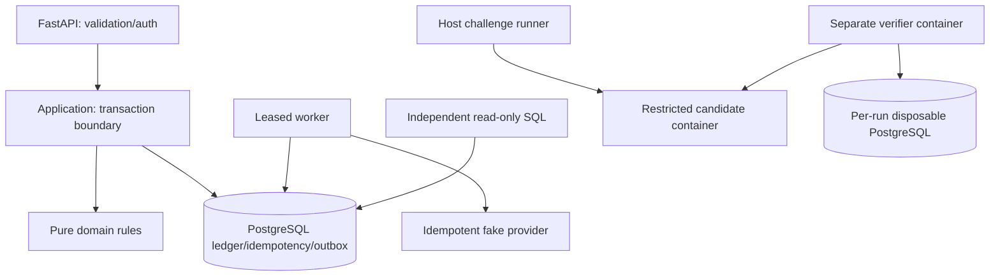

# Architecture

One modular monolith keeps financial effects inside one ACID boundary.
Module layout is intentionally smaller than the illustrative SRS tree; modules remain cohesive.
See ADRs for guarantees and rejected alternatives.
